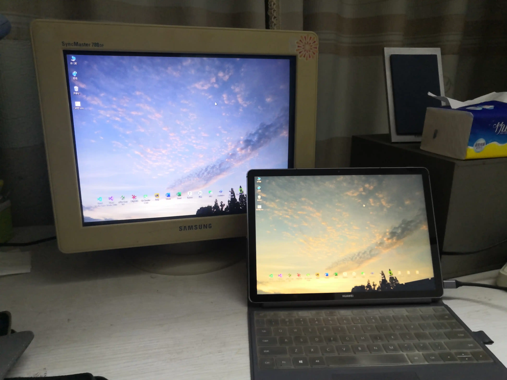
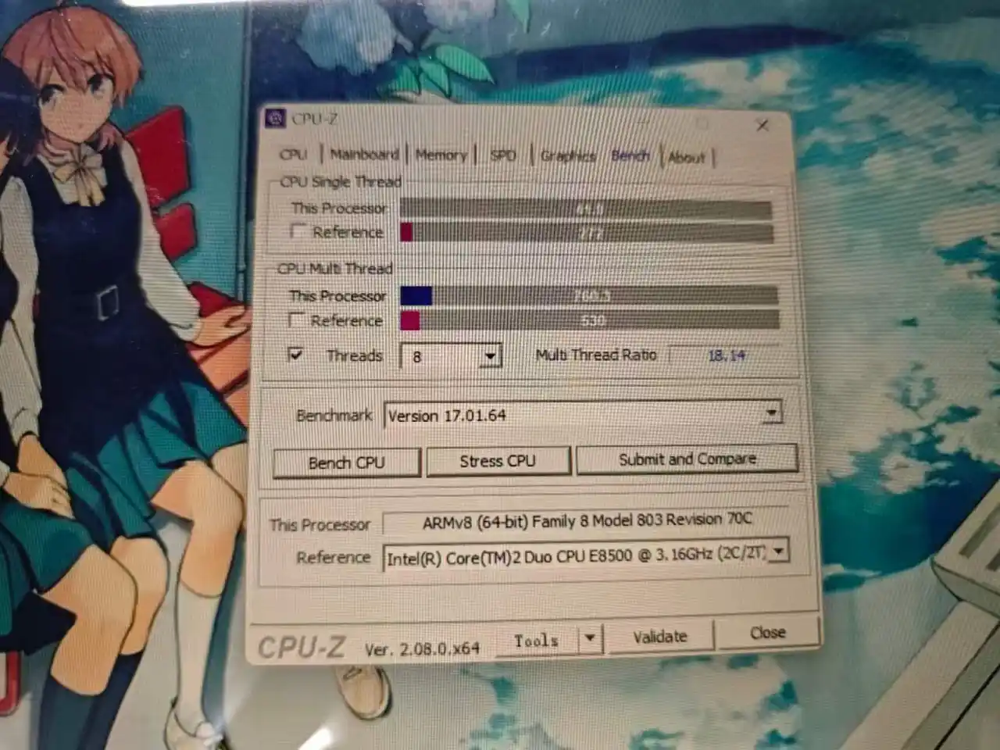
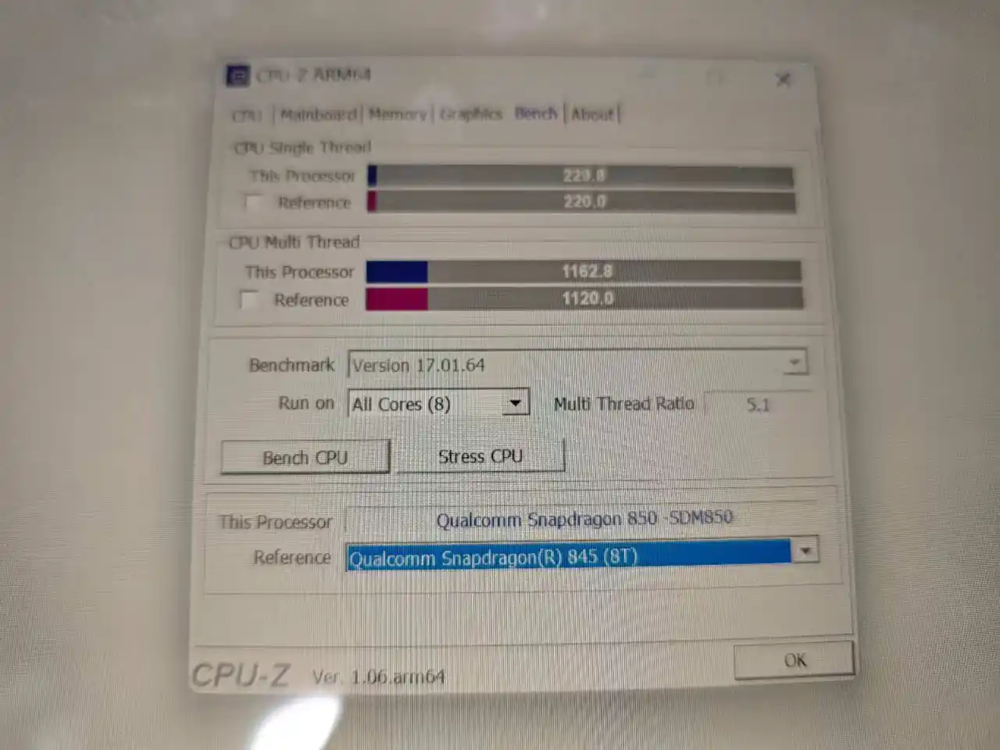

## 总述

HUAWEI MateBook E 2019，可以说是我大规模折腾电脑的一个开始。可能是兴趣使然吧，不过更多的，还真就是，不折腾压根没法用。

什么兴趣，什么关于 Windows 平板的折腾，什么对于 Windows On ARM 的研究，我最初真的只是想让这台电脑能真正像一台电脑而已。

但就是这么一台电脑，可以说，从小学一路陪我走到了大学，也是非常以外呢。

## 相遇

也是六年级吧，妈妈花了 4999 买了这台二合一电脑。在那个时候，消费级的二合一电脑可是很高级的存在，更何况还是搭载的高通骁龙的芯片，这更是闻所未闻的。有了真正属于自己的新电脑，当然还是很开心的了。（当然，在此之前还有一台 Samsung NP N148，不过这台 2010 年的上网本各方面都太落后了）

然后，自从发现这台机子无法运行 64 位软件，一切噩梦就开始了。对于一个六年级的小学生来说，确实很难理解，为什么 64 位的 CPU 安装不了 64 位的 x64 软件。明明家里 2012 年的 Lenovo IdeaPad Z380 的二代 i3 都能运行的说。而且，即使是 32 位软件，运行的速度也挺慢的。

也得亏当时不知道找各种开源软件，都是从一些垃圾下载站下的软件，所以很多软件版本比较旧，不少支持 32 位的。而且，在一次“安全下载”之后，也认清了那些捆绑包的真面目，也算学了一招。

六年级，也是我第一次搞到 Galgame 的时候呢。当时在网易云音乐上听《壳之少女》的 OST，觉得很好听，于是在各处找资源。也是废了好大劲儿才找到的，还要手动打补丁。玩的时候也是奇怪，为什么一个 PPT 式的游戏这电脑怎么还加载这么慢。不过这个版本的资源，汉化补丁存在 Bug，推进到一定程度后会直接崩溃，于是没推完（这个坑要到高二才补上）。

中途才想到，要安装 arm64 适配的软件呢，但是适配的软件真的少之又少。好不容易随着时间发展，生态起来了，但是大部分软件都针对 8cx 系列新的芯片优化，骁龙 850 运行起来依旧不算流畅。

## 不算完美，但曾是绝对中坚

虽然父母也很开明，说大不了再买一台正常一点的笔记本好了。不过自己也觉得凑合还能用吧，所以一直撑着。拒绝性能焦虑嘛。

还拿来跑过 Visual Studio，那真的是一场酣畅淋漓的性能释放啊，我真的很难想象我当年是怎么在这么卡的 IDE 下写程序的。

虽然有种种不足，但是这台电脑伴我走过了大半的 OIer 历程，我也用这台电脑写了大量的笔记记录，还安装过 WSL。

游戏上，这台电脑真的，跑什么都看脸。MAME 跑个《打击者 1945》都会掉帧，《铁锈战争》这种我用上古安卓机 Galaxy 2 都能跑的游戏都无法运行，但是却能流畅跑《雷电 V》，对于游戏的兼容性真就玄学。

## 第一次瞥见 Windows11 的风景

21 年的时候，有推送 Windows11 的更新呢。骁龙 850 刚好卡线符合配置要求。想着以前也没有体验过 Windows11，升级一个也无妨。

然后，就是另一个噩梦的开始了。

### 大删特删

毕竟要空出一大半用于安装嘛，就要对 C 盘做大扫除。然而，C 盘最初分区的时候分太少了，以至于几乎要把 C 盘文件清空才能升级。

不过，我是什么人呢！人家那时候用的还是 32G 的手机呢，想要玩个《Modern Warships》又要占掉 7G，系统预装 10G，还要装微信和 QQ，剩下空间真就捉襟见肘，硬是把我逼成了空间管理大师。如此小清扫，自然不在话下。

### 漫长的安装

WoA 的安装必然不是一帆风顺的。安装慢我能理解，但是能从早上一直装到我晚上吃完饭我是真的没想到的，记忆犹新。人家用 CD 装 WindowsXP 都没用这么长时间的说。

查了下，发现安装过程，还要边装边转译 x86，而那转译效率，不用说，是非常低下的。

### 可有可无的更新

装好好，Windows11 并没有带给我太多的惊喜。我个人非常喜欢 Windows10 下的，屏幕左边缘滑动显示时间轴的功能（相当于`win + Tab`），非常方便，然而 Windows11 把这个手势改为了推出所谓的“小组件”（实际上大部分都是“小广告”）。

系统明显卡了很多，不过毕竟是早期 21H2，优化没有上来，可以理解。不过悲剧的是我的设备是升级不到更高版本的 Windows11 了，就只能受着了。

终于支持了对于 x64 应用的转译呢！这也是我当初升级的初衷。不过运行相当卡顿，根本没法用，可有可无。

回退 Windows10？我可不想再经历一次老半天的安装过程了，于是作罢。

## 配置

终于说到配置了呢。我真要好好拉出来批判下了，这台设备，完全就是外围拉满，核心拉跨的典范。

### 外观

磁吸键盘，平板后盖都是真皮，摸上去非常舒适，也非常高级，很有商务范儿。不过多年后掉皮就又是很头疼的事情了。

平板本体仅 600g 左右，非常便携。

### CPU & GPU

性能可谓相当惨淡，在各方面都被家里那台二代标压 i3-2370m 吊打（跑分大概单核 200，多核 570）。

实际上多核比我想象中还好一些呢，不过这个单核真的太幽默了，属于被 Atom 系列暴捶的那种。

ARM 架构下的跑分还算是有一台 2019 年机器的样子。理论上来说骁龙 850 就是骁龙 845 的超频版，除了主频略高没有任何区别，这个跑分结果也是意料之中。

不过，也是很少有软件能完全发挥出这颗 CPU 的潜力。要真正看看她的真实实力，还是得看我下期在 Linux 下的测试啦！

至于 GPU，这个比较难说。和 CPU 一样，很难发挥出应有的实力。（一部分程度上也是因为一些图形库不支持）

跑个有动态效果的 Galgame，比如《泡沫冬景》，就非常卡。但是在 4k 高画质下玩 2014 年的 2.5d 同人 STG 大作《Astebreed》帧数还能保持在 30 - 60Hz，就很奇怪。（不过《Astebreed》的优化确实离谱）

### 硬盘

这真要好好说说了。用 CristalDiskinfo 和 CristalDiskMark 根本读不出硬盘信息。后来一查才发现是类似于手机内存的 EMMC 方案。

好家伙，我这某种程度上也算是提前用上鸿蒙电脑了。（当然，也是因为这台电脑，让我发誓这辈子再也不会碰华为的消费级产品）（不过高中还是不得不用了 NOVA3 三年，大学才换的 Redmi K70）

速度上，觉得完全不如 m.2 硬盘，和 SATA SSD 一桌。

可惜了，但凡是个 512g 的 m.2 硬盘，这台机子在闲鱼上也不至于 400 都没人要。

### 摄像头

前后摄都配备，13MP 后摄在很长一段时间比我手机还强。有时候用来拍照，交作业非常好用。

配合支架，以及本体不小的硬盘，很长一段时间都被我架点录像用。

### 键盘

磁吸键盘，手感只能说不差，但也绝对说不上好。

二合一的通病，排线非常容易断，现在这台在 2022 年的时候，基本上键盘就没法用了。

而且键盘时间长了还容易掉皮。平时就直接当支架用了。

### 电池

也是第一次让我对电脑没了续航焦虑。现在不开省电模式都能用三个多小时，以前五个小时绝对不在话下。

低功耗也是当时 ARM 架构处理器的 Windows 平板的一大优势呢。（或者说也是唯一优势）

### 屏幕

12 英寸，2160 × 1440 3:2 的 LCD IPS 面板，70% NTSC（相对 45% NTSC 好太多了），非常优秀的一块平板面板。平时用来看电视，浏览文档都非常舒适。

### 扬声器

双扬声器，外放还可以。不过第一声会有破音。

### 接口

放所有 Windows 平板中，也算简洁的。连 MacBook Neo 都不如：

- 3.5mm 耳机孔
- Type-C 全功能
- SIM 卡插槽
- TF 卡插槽

侧边还有音量按键，以及指纹识别模块。

外接东西全靠拓展坞。拓展坞还得买带 PD 供电的，否则借个键盘或者 U 盘就充不了电了。

不过得亏是给的全功能 Type-C，外接 4k 60Hz 的显示器还是可以的，日常办公很流畅。

## 未完待续

在 Windows 下表现拉跨？转战 Linux 或重获新生？

在克服种种驱动困难，修改种种困难之后，我们的 Matebook E 2019 大小姐能否焕然一新，大杀四方？

敬请期待 iNITAL 的垃圾站：“大强兼”时代的受益者——HUAWEI MateBook E 2019（下）~