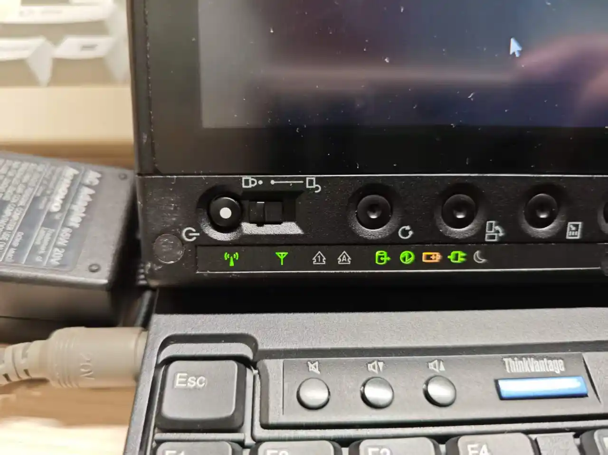
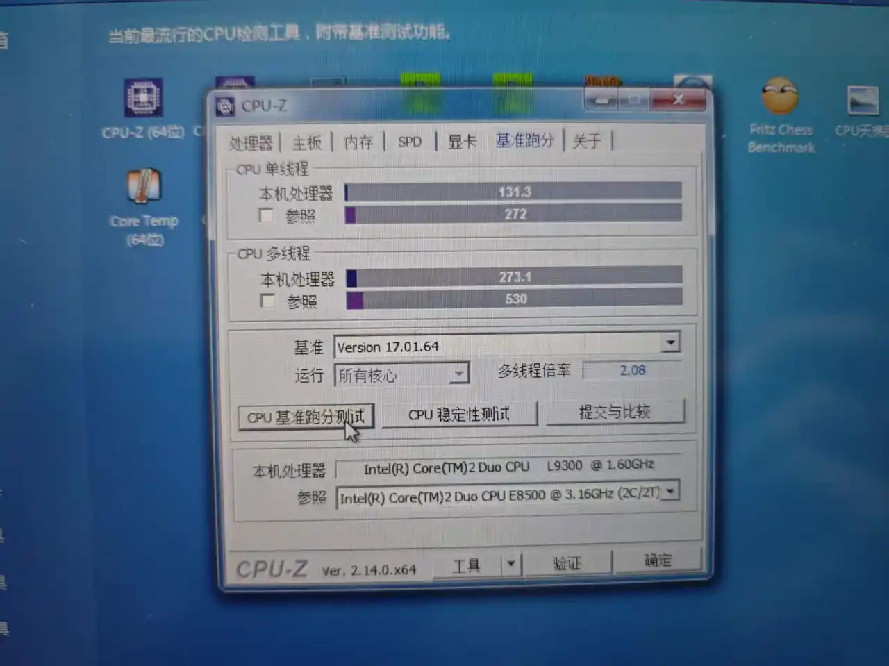

# 

## 缘起

曾经 200 元收过一台 ThinkPad X61 Tablet，个人用下来，除了触控体验，以及更好的屏幕，其他方面都全面不如 X60（指性能上，标压和低压还是差别太大了）。故后来以 300 的价格卖出。

虽然赚点小钱很开心，但是自那以后，就对这类机器念念不忘。后来 X60 被自己升级网卡的过程中，弄坏了主板，只能依依不舍地出掉了。虽然依旧小赚一笔，但是，那可是贴着 IBM ThinkPad 标志的 X60 啊！作为最后一代贴有 IBM 标志的 ThinkPad 还是相当有纪念意义的。（不经意间开了两个坑呢）

于是，咸鱼上看到了 218 元的 X200t，也是毫不犹豫下单了。虽然也有很多卖 235 的，但是那些都不带内存硬盘，相对来说，没有这台划算。（要知道很多人 X200 都敢卖 200 多）

## 购买时的小插曲

首先，卖家绝对不懂电脑。图片里只是系统坏了而已，真不至于当坏的出。而且拍的 BIOS 界面也不懂，使用豆包解析，然后贴到图片里的。

后来经过聊天，卖家表示这是他孙子的电脑，孙子考上大学，给他买了新电脑。重装系统问了电脑店，需要 100 元（什么电脑店，这么贵，不就几分钟的事嘛），觉得不划算，就把他之前的旧电脑卖了。

这么说我还是有点同情他孙子的呢，这种机器一般是收藏的，不是日用的啊！估计他回家后直接天塌了。处于良心，还是问了老人有没有经过他孙子同意，结果人家表示没关系，那我就下单了啦~

不过这个老人不会改价格，也不会弄邮费之类的，教了好几回都不会。发货的时候还是咸鱼默认，最后快递员说不能发电脑（这个理解，我第一次卖电脑也踩过这个坑）。最后摆烂，多交了 20 的邮费。（但是，就算是顺丰，你邮费是怎么给我干到 48 的？我发京东都没这么贵）

不过东西还是很全的，电脑 + 适配器 + 触控笔 + 鼠标，还是挺有诚意的，一般就个人卖家会给这么全。

特别是那个联想原装的鼠标，虽然也就二十几块钱的东西，但对我来说也是挺有用的。别看我电脑多，能用的鼠标没几个，很多旧机器还在沿用 2000 年的罗技低端鼠标，还有很多鼠标有双击问题，现在用的几个无线鼠标有很严重的信号干扰问题。这个刚好填补了我有线鼠标上的空白。

## 原机主的遗产

毕竟是故障机，里边的数据也没有清空。上边有一些学习资料吧（~~正经的不正经的都有~~）。现在庆幸还好被当成故障机卖掉了，但凡他爷爷做个数据恢复，翻一下文件夹，这不得社死？

还有不少 360 浏览器之类的软件，总觉得似乎也不像是很懂电脑的样子。

## 外观

整体非常干净，收了这么多旧电脑头一次见到这么发亮的电脑，前主人绝对是很爱护的。

基本上延续了 Classic ThinkPad 的设计，不过和 X61t 一样，没有顶部键盘灯。

真的，每次都会被 ThinkPad 的这种灯条硬控我好久。真的，同样是廉价 LED 灯条，ThinkPad 的质感就不一样，不知道是不是心理作用。虽然塑料 + 亚克力面板的薄膜还是不如 IBM 时期的玻璃镜面，但胜在灯多啊！如果是支持蓝牙的版本还有一个蓝牙的灯，看着十个指示灯闪烁真的很漂亮！

## 配置

简单谈一下硬件吧，不过这种机器，谈性能意义不大。

### CPU & GPU

Core 2 L 9300 1.60GHz，并非 L9400 1.86GHz 顶配。两者缓存、工艺等方面都差不多，也就主频有区别。不过，这个主频差得还是不少的呢，两者在跑分上还是有一些差距的。

看了下其他人的跑分，L9400 单核 160 多，多核大概 300 出头。

至于 GPU，相对于 X60 的 GMA X3100，GMA 4500MHD 实际上个人感觉提升不大。最主要的区别是支持 DX10，但也只是“能跑”的水平。

理论上来说，DDR3 相对于 DDR2 的内存带宽提升吧？然后一看，X200t 只支持 1066MHz 频率的内存（更高的条子会自动降频），连 1333MHz 都跑不到，是我见过频率最低的 DDR3 机器。要知道用 DDR2 的 X61 内存带宽也有 667MHz。这点提升放在现在看影响不大。

总之，我拿 X61 跑着比较卡的游戏，在 X200t 上依旧不算流畅。

不过，话是这么说，对于东方 Project，特别是后续需要 DX10 的作品，相对 X60 还是有明显提升的，至少我打 L 不会掉帧。另外，对于 H.264 视频的解码也好于 X61，看高码率的 1080p 视频也不会有明显卡顿。

### 内存

实际上上边说得基本差不多了呢。原装是 2 * 2 的条子，说实在，2GB 在如今内存暴涨的行情，价格依旧下水道、不过升级 4 * 2 似乎意义不大，个人暂时没有升级的意向。

### 硬盘

自带 500G 日立硬盘，使用时长 1000 小时都不到，也搞不清楚到底是自用的还是清零盘，不过看着还行。

5400RPM，也算那个年代的标准转速。虽然手上有一块 128G 的杂牌 SATA 固态，不过想想反正装的 Windows 7，无所谓了。（有前车之鉴，不敢转 Windows10，这类特种机器很依赖特殊驱动，而这些特殊驱动在 Windows10 下很可能无法工作）

依旧是拧下一个螺丝即可更换的硬盘，这一点我非常喜欢，准备日后用杂牌 SATA 装个 Windows10。改天需要换系统直接换硬盘就可以了。也可以考虑 Ubuntu，之前用 X61t 装过，驱动支持相当完美，不过因为 CPU 缺少指令集有些软件装不了。

### 网卡

支持 3G LTE 上网，不过这个功能放现在是彻底没用了，3G 基站现在都没几个了。

原装网卡为 Intel 5100 AGN，放现在肯定是不够看了，连蓝牙都不支持的玩意儿。不过不同于 YOGA 3 11，X200t 虽然也有白名单限制，但是社区有解除白名单限制的 BIOS 刷写软件，如果要更换 AX200 还是很方便的。（给 X200 装 AX200 想想也挺有意思的）

但是之前给 X60 更换网卡的时候烧坏了主板（我也不知道为什么，起初是变成只支持单通道内存，到后来进 BIOS 都成问题），给我整出 PTSD 了，加上手上有 AX300 的 USB 无线网卡，也不是不能用，暂时没有更换的想法。

### 屏幕 & 触控

1280 * 800，TN 屏，但是有 LED 背光，亮度没有明显衰减。虽然分辨率不怎么样，但怎么说也是 16:10，观感上还能接受。 

之前用 X61t 的时候，那块电磁屏还是与边框有一点凹陷的（实际上你看现在大部分笔记本屏幕距离边框都有一定凹陷），但是我这一台竟然是纯平的？！虽然现在的平板纯平也是常识，但是在 2010 年还是很少见的啊。（实际上很多 X200t 的版本也不是纯平的，我这算是运气好）而且这块屏幕很有意思，表面的磨砂玻璃与内屏之间还相隔了好几毫米，一个 LCD 屏幕硬是给我整出了像是 CRT 那种表面覆盖一块几厘米玻璃的感觉，非常有意思。在质感上可谓独一无二。

作为触摸屏，当然是要好好体验的啦！

安装的全补丁版的 Windows7，各类相关软件啊、支持啊基本上不会出问题。实际上，单纯就书写体验来说，这块仅支持单点笔触的电磁屏，实际上性能是不输很多廉价数位板的。由于不支持手触，所以可以肆无忌惮把手搭在屏幕上，根本不用担心误触好吧！如果你要问，那么缩放，移动之类的操作怎么办呢——那不是还有手感超好的七行键盘嘛！完美！

不过有一点还是要吐槽：屏幕的按键面板取消了 X61t 的方向键，没有之前那么方便了，算是个退化。

对了，还有一点不得不提，就是它那猎奇的自动旋转。作为早期的 Windows Tablet 产品，它当然是不直接陀螺仪判断位置的（不过把这么厚的本子竖起来也不现实），而是使用了个 Active Route 功能（~~没错，就是这么个功能也要起一个高大上的名字，ThinkPad 的逼格就是这么来的呢~~）。使用前需要矫正，就是拿着这个笔记本转来转去，估计通过转轴判断的位置吧？不过实际效果不如直接按面板上的旋转键来得方便。

### 电池

之前我收 X61t 的时候，那个电池就只能撑 10 分钟，不过这已经很好了，大部分这类机子的电池都饿死了。我这台 X200t 也不例外，充不进去电。这类机器的电池似乎有钱都买不到，咸鱼上根本没有相关链接。要整只能自己手搓。但是 X200t 的电池又不像 X200 那样简单粗暴整几根电芯就行。而且，由于 ThinkPad 超级高的安全保护系数，一旦电池有任何挪动和异常，就会立刻断开保险，且芯片上也会有记录，机器插上基本上是用不了的。问了 AI，只能带电操作，或者整编程器给芯片刷写数据。电芯焊接方面，用电烙铁似乎会直接爆炸，最好用电焊机。还好查了 AI，不然我可能真就直接买几节电芯，拆开更换，然后直接上电烙铁了。捡回一条命。

虽然卖家送了适配器，不过，X200t 和 X61t 的适配器是通用的，似乎也不是刚需。

总之，这台机子的定位越来越像“固定工作台上的数位板”了。

### 扬声器

这个想想还是单独说一下。之前用 X60 和 X61t 的时候，都是非常雷人的单扬声器，而且还放在一角，听上去就只能听个响。在 X200t 上看到大尺寸的双扬声器还是非常以外的。别的不说，声音是真的大，开机自检那一声“滴”是真的吓着我了。在我用过的笔记本里属于非常有力气的哪一类。

### 键盘

久仰 X200、X201、X220 这一系列机器的七行键盘的大名。如今用起来果然不错。从 X60 的 4:3 的屏幕比例挣脱出来之后，键盘布局更加宽敞，手感也更好，和之前用的宽屏版的 T61 差不多。（不经意间又开了个坑）

### 接口

接口如下，个人觉得和 X61t 除了接口布局完全一致。

- USB 2.0 * 3
- 3.5mm 耳麦插孔 * 2
- SD 读卡器
- VGA 接口
- 网线接口
- 电话线接口（很意外，2010 年了依旧保留了 Modem ）
- 触控笔插槽

当然，如果要拓展的话，可以使出 ThinkPad 的传统配件——拓展坞！接口上肯定是不用担心的。

## 未来方向

可能考虑买一个拓展坞？也不贵，不过一想到从 X200 开始，拓展坞的光驱就从 IDE 改为了 SATA，读盘性能没有之前那么稳定了，所以拓展坞对于我的吸引力就大大下降了。真是越来越怀念我那台 X60 了，他的拓展坞自带索尼光驱，读盘、刻录都非常稳定，可惜在 X60 废掉之后也一并卖了。

如果可以，或许还可以破解白名单，升级网卡，把内存升级到 8g，好像也就这样了。