

*（配合音乐食用更佳~ 个人最喜欢的 Sakuya 同人曲~）*

T430 是我极其喜欢的一台 ThinkPad，在这台机器上我进行了大量的改装，基本上除了主板其他配件全都换过，其拓展潜力可谓逆天。

而且，作为最后一代 Classic ThinkPad，这台机器也有一定的纪念意义呢。也是我所有收藏 ThinkPad 中最有实用价值的。

这一期写得稍微有点多呢，实际上很多都不只是 T430 的成分了。以后关于 IBM ThinkPad 的笼统介绍应该要少一点了，这里有点过于泛滥了。

## 外观：IBM 最后的波纹

保留了一切 IBM Classic ThinkPad 的特征：

1. **系统状态跑马灯**
   
   可惜这个时候灯的数量已经很少了，只保留了最关键的数据传输和网络连接。

   顺便一提，也是最后拥有实体 Wifi 开关的一代。

   这个实际上不是 ThinkPad 专有的，同期很多电脑都有类似的指示灯，但是个人觉得其中 ThinkPad 最有高级感。

2. **屏幕卡扣**
   
   非常实用的设计呢，卡上去，笔记本随便甩，屏幕就是不打开。

   ThinkPad 最初的设计就是“像便当盒一样的机器”，每次开屏幕都滑动一下卡扣，然后说一句“我开机了~”，真的有种开饭盒一样的仪式感好吗！

3. **键盘灯**（**ThinkLight**）
   
   在背光键盘还不是主流的时候，ThinkPad 就给出了从屏幕顶部一颗 LED 投射光到键盘上的方案，就像开了个小台灯一样。个人觉得还是非常优雅的。

   不过 ThinkLight 的命运和屏幕卡扣是高度绑定的。因为屏幕卡扣的出现，屏幕上半部分加厚，这样才能塞进一颗 LED。

   可惜，有些人就特别在意所谓“屏占比”，非要把边框缩到看不见。这样固然优雅，但是屏幕本身的强度被忽视了，而且更换屏幕也变得困难了，觉得得不偿失。个人认为把边框控制在 0.5cm 以内的都能接受。

4. **七行键盘**（**伪**）
   
   只需要对 T420/X220/W520 的七行键盘做一定的裁剪，加上破解白名单，就能无损装到 T430 上。

   对于我这种新生代，我是无法理解老人们对于七行键盘的执着的。我承认七行键盘的手感是笔记本界的 T0，但是七行的布局真的那么重要么？确实，七行键盘做到了 Home、End、PageUp、PageDown、Delete 几个键的盲操，对于经常浏览文档的人来说确实实用，但是新布局适应下用起来效率也不差吧？个人更觉得是他们不想改变过去习惯造成的偏执而已。

5. **防滚架**（**Roll Cage**）
   
   这个实际上没有绝迹，在现在的 ThinkPad P 系列还是能看到的。

   拆过 T430 的人都知道，这玩意儿设计是有多么结实。防滚架的出现，让 ThinkPad 的强度堪比 NOKIA。防摔什么的都是基本操作。

   防滚架实际上还有一个很大的作用就是保护机械硬盘，在跌落的时候为机械硬盘提供缓冲，不过这个功能现在的确淘汰了。

6. **防泼溅键盘**
   
   键盘直通底部导水孔。如果只有少量饮料不小心洒在键盘上，水会被导到桌面上，顶多报废一个键盘。而 ThinkPad 的键盘更换相当方便。

   当然，我是没有试过的，希望永远都不要用到这个功能。

7. **底座式拓展坞**（**UltraDock**）
   
   这个实际上不是最后一代。T480 依旧支持底座式拓展坞。个人一直觉得这种方案比雷电拓展坞更优雅。

   不过淘汰的原因也不难想：需要专有接口，泛用性不强。

   现在我用的就是 40AC 雷电 3 拓展坞，如果底座式拓展坞不淘汰，我其他机器还用不上 Think 系的拓展坞呢。有得有失吧。
   
8. **Think 专用软件**（**ThinkVantage**）
   
   一些企业级的功能吧。后续机型还有，不过随着 Windows 自身功能的完善渐渐减少，近几年直接绝迹。Lenovo Vantage 算是精神续作。
   
   虽然功能上鸡肋，但是有这些软件装着，真的非常有高级感好吗！

9.  **小红点**（**TrackPoint**）（**指点杆**）
    
    ThinkPad 最显著的标志。个人认为 TrackPoint 使用起来远好于传统触控板。

    不过，随着 ThinkPad 键程的缩水，指点杆的稳定性也大大下降，以至于指点杆漂移的问题频发。

    随着全域压感触控板在 Windows 阵营的普及，TrackPoint 也不再有手感优势。现在很多 ThinkPad 都把指点杆换成了压感触控板呢。
   
    不过，在工地、工厂、极地等佩戴手套的极端环境中，指点杆依旧有独一无二的优势。就凭这一点，小红点应该永远不会淡出我们的视野吧！

10. **完善的备件制度，高可维护性**
    
    怎么说呢，现在的 ThinkPad 依旧延续了这一点呢，而且还更自由（因为没有白名单限制）。

11. **APS 硬盘保护系统**
    
    当加速度传感器检测到跌落时，会立刻停止硬盘读写，以保护机械硬盘。不过这个功能明显也淘汰了。

12. **金属立轴**
    
    现在是只有游戏本和高性能本才会有的设计呢。当年 ThinkPad，不管轻薄本还是性能本，一律立轴，也使得屏轴稳定性相当好。

在 T60/T61 时代，机器上的“IBM ThinkPad”逐渐被“Lenovo ThinkPad”取代。BIOS 界面巨大的三色 IBM 也随之消失。

在 T430 之后，从 IBM 那边继承的设计语言大多消失殆尽。对于 Lenovo 来说，似乎终于逃脱了“改良 IBM”的阴影；对于 ThinkPad 爱好者来说，一个时代正式落幕，世上再没有 IBM ThinkPad。

## 配置：宝刀未老

### CPU & GPU

T430 的 CPU 为 PGA 封装，可更换，这就给了非常大的可操作空间。虽然能上 i7-3740QM，大力出奇迹（单核 413，多核 1977），然而 45w 的功耗，小小的单热管散热器绝对压不住。于是选择了 35w 的 i7-3632QM，依旧是四核八线程，性能也不弱，运行 Windows11 完全没有卡顿。

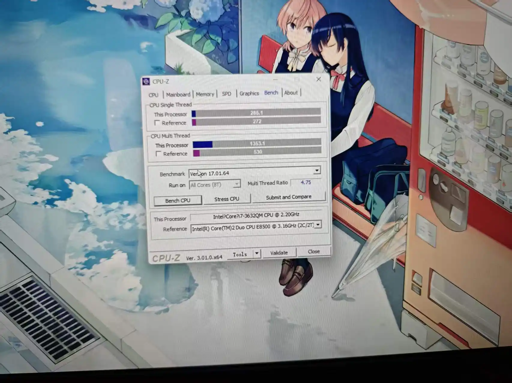

这个成绩直接把我玩过的一众 Windows 平板轰成渣。多核性能一路杀到 i5-8250U，八代之前，那些双核四线程的低压 i5 完全不是 3632QM 的对手。

HD4000 的集成显卡倒是成为了机器的瓶颈了。不过玩大部分 STG 都是没问题的，硬上解码 4k 也不是不行（但是这机器最高输出 2k，意义不大），平时跑个动态壁纸也没多大负载。

虽然 HD4000 性能不佳，但其一个特质被忽略了——支持直接输出至 CRT 电视。这一点，很多新的 Intel 核显都不支持。也凭此能把 T430 连着我那几台古董 CRT 爽玩。（这个后面会提到）

实际上还是有 nVidia NVS 5400M 的独显版，不过驱动支持，对于黑苹果以及 Linux 的支持都不完善。与 CPU 共用单风扇散热，只会让本来就处于功耗墙边缘的 CPU 直接撞死降频，得不偿失。嫌独显性能不够，还是直接外接个 GTX 960M 吧，那才叫质的提升！

### 内存

原装 DDR3 1600MHz 4g*2 1.5v 标压，后来升级到了 4g + 8g 的组合，觉得也够用了。

主要是标压的条子真的难找，虽然换低压实际上不会有性能损失，但本人依旧对标压有一定的迷信与偏执，故作罢。

听说还能上 2133MHz 的条子，性能直逼低端 DDR4，不过保险起见，还是没有尝试。

### 硬盘

本台机器的硬盘拓展可谓逆天，最多能上四盘位：

1. 2.5' 主硬盘位
2. 2.5' 光驱位硬盘位
3. msata 硬盘位
4. Express Card 可选配 msata 或 m.2 硬盘拓展位，提供 PCIE 2.0 * 1 的速率
   
如果要做 NAS 的话，这台机器也很合适呢。

最终主盘位上了 256g Intel 企业级固态。（实际上是被淘宝卖家以及各种无良 UP 主忽悠的，实际上不算顶尖，但在 SATA SSD 也能混个中上）

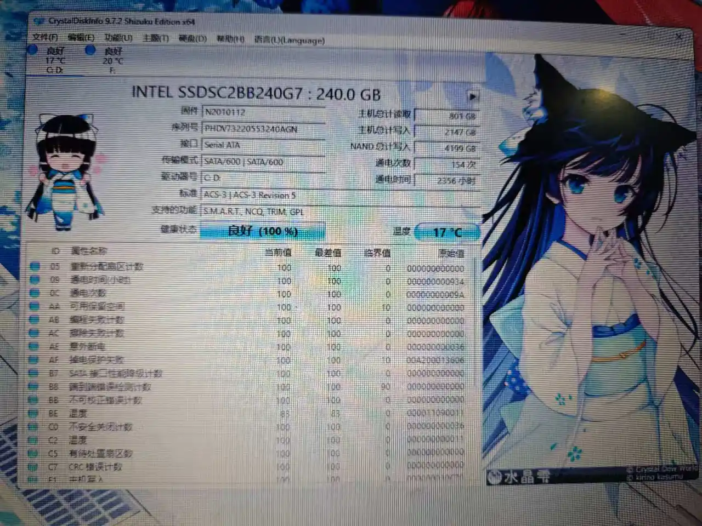

还有一块 128g Intel 企业级固态，一看读写时间都上万了，不过健康度还行。装了 MAC OS 备用。

另有一块 128g Kingston 固态硬盘，最初买 X60 时自带的（不得不说那个卖家真的良心，别家都发杂牌固态的），装了 Arch Linux。

需要换系统的话，依旧只需要拧下一颗螺丝，拆掉硬盘盖板即可。

当然啦，要真正实现方便的更换，还需要硬盘托架。淘宝上大概 10 元一个吧。不过刚好 X60 坏了，X60 的硬盘托架除了某处有两个突起，其他似乎和 T430 区别不大，故稍微做了点小改造，废物利用。

### 网卡

原装是 Intel 6205 网卡，性能实在不太行，加上想折腾黑苹果，故刷了白名单，换为 BCM 94352hmb。

虽然性能好了很多，而且也支持了黑苹果，但是在 Linux 上驱动机器折磨。也因此对博通的网卡产生了阴影。

### 屏幕

原装 1600 * 900 TN 屏幕，在当时属于高分屏（相对 1366 * 768）。但是亮度很低，而且色彩一塌糊涂（我这个色弱都看不下去了）。本来想着凑合用，但无奈后面出现了花屏、色带等问题，决定一步到位，直接换屏。

刚好，淘宝有卖 T430 升级 FHD 的套件，虽然有点小贵（180 元，对于一个本质转接板的东西来说，溢价确实很高）。又花 90 收了一块 B140HAN01.3 1080p IPS A- 屏。虽然是 A-，但是那点小瑕疵可以忽略不计，性价比还可以。色域来到了 72% NTSC 比原来的 45% 好多了，加上更高的分辨率和更好的亮度，个人觉得挺值的。

在咸鱼上看了下改屏的服务，一次大概要 400 以上吧，自己动手还是省了 100 多的，总觉得以后也可以做这种兼职呢~

### 键盘

经典的巧克力键盘。我个人还是非常喜欢的。键程上，也是 2.0-2.5mm，和七行键盘实际上相差不大，手感依旧 T0，甚至觉得比七行键盘更顺手一点。

而且 T430 键盘还带两档键盘背光，这一点是七行键盘没法比的。有背光的同时还有 ThinkLight，也是兼顾了新老用户的使用习惯呢。

可以稍加改造直接上 T420 的七行键盘，cosplay T420 终极版。

### TrackPoint & 触控板

TrackPoint 的优秀手感自然不必多说。

触控板是那种磨砂质感的，摸起来像粗糙的纸张，与如今各种丝滑的镜面触控板截然不同。但是手感很不错。采用了双实体按键 + 纯平版面的设计，个人觉得也比跷跷板式的触控板好。唯一要吐槽的点就是面积太小。可惜后续的 ThinkPad 并没有沿用这种触控板。

### 电池

健康度只剩下六十几吧，不过这种东西没饿死就已经运气很好了。能用一小时左右，勉强还有一点便携性。

### 接口

相当齐全：

- USB 3.0 * 2
- USB 2.0 * 2 （其中一个支持 Always On USB）
- VGA
- Mini DP
- NFC 读卡器
- 3.5mm 耳机孔
- SD 读卡器
- RJ-45 网口
- 3G 流量卡插槽
- UltraBay （可选择拓展硬盘/光驱）
- **Express Card 接口**
  可选配各种模块：
  - USB 3.0 * 2 拓展卡
  - m.2 固态硬盘拓展卡（受限于 PCIE 2.0 * 1 的带宽，最高跑到 500MBps 左右）
  - msata 固态硬盘拓展卡
  - **PCIE * 16 显卡拓展坞**（支持 GTX 750Ti、GTX 960 等显卡，再高不支持，也没必要（带宽跑不满））
  - 空白塑料填充（这个还是挺重要的，很多二手机器都把这个丢了，这么大个接口空着总归不美观）

Express Card 使得 T430 有了非常高的硬件自定义水平，可以根据需要更换特定模块。

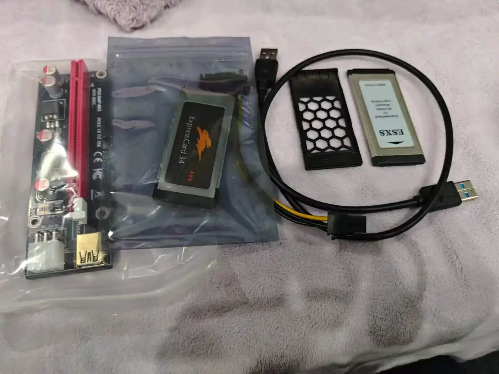

额外说一点，这个光驱令我非常头大，或者说所有笔记本 SATA 光驱都令人烦恼。由于不像 IDE 一样有独立供电的特权，很多笔记本为了省电，平时都是不给光驱通电的。但是真的要用的时候唤醒光驱真的非常烦。

### 4337 拓展坞

如果还嫌 T430 本身接口不够？那就上 4337 拓展坞吧！

接口如下：
- USB 3.0 * 1
- **USB 2.0 * 5**（恐怖如斯）
- VGA
- DVI-D
- DP 1.4
- RJ-45 网口
- 3.5mm 耳机孔
- 3.5mm 麦克风孔

设想一下，如果你给 T430 的 Express Card 上了 USB 3.0 拓展卡，再套上拓展坞，那你总计会有 4 + 2 + 6 = 12 个 USB 端口！我台式机都没有这么豪华的接口阵仗。

而且 VGA + DVI + DP 的组合，可以做到新老显示器通吃，非常方便。

觉得显示输出还不够？那也可以外接一张显卡！

不过，虽然听着很唬人，但是如果你把拓展坞上 6 个 USB 全部插满的话，你用无线鼠标信号会有严重干扰。（这一点和台式机一个道理，把无线接收器和移动硬盘插在一起，就很明显）

### 电源

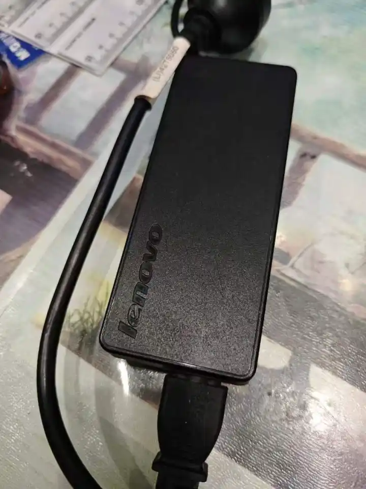

体积非常大，非常重，外观真就像个黑色的板砖。觉得扔出去能砸死人。

实际上用 X60 那个 65w 的电源也不是不行，集显机，也没上 3740QM 这种 45w 核弹，65w 也够用。不过实际上 65w 的电源也没小多少就是了。

而且 90w 的电源，配合 4337 拓展坞，也不用担心插太多移动硬盘供电跟不上。

顺便一提，Windows11 的电源管理本来就非常猎奇，在这种老机器上更是水土不服。睡眠模式下经常键盘醒不来，以至于锁屏界面开不了机，就很诡异。

## 拆机：西装革履的顶级硬汉

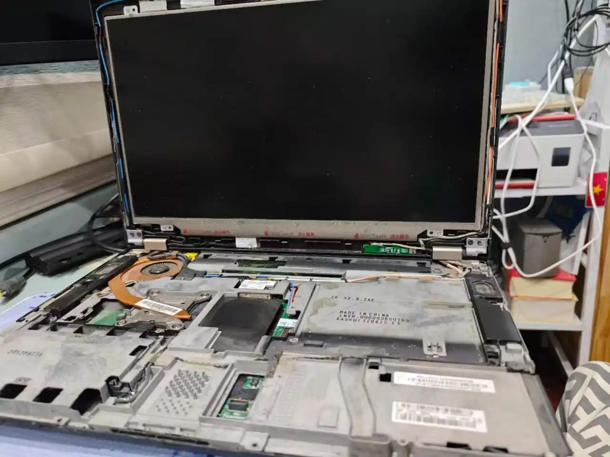

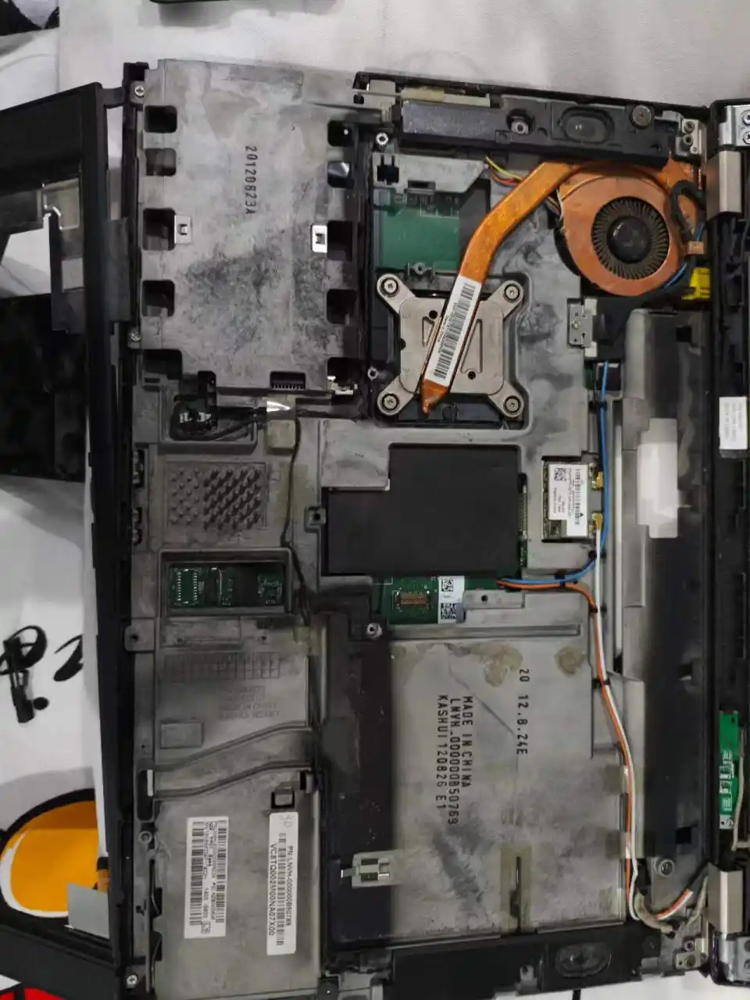

一些细节：
- 第二根内存插槽表面有黑色塑料片覆盖
- 硬盘、Express Card、UltraBay 周围被镁铝合金全覆盖，整块主板也完全被防滚架淹没，非常结实（这下知道为什么 ThinkPad 摔不坏了吧，只要这层镁铝合金不碎掉，那么休想伤到主板）
- 触控板底下有突起，不管用多大力戳触控板也不会下凹

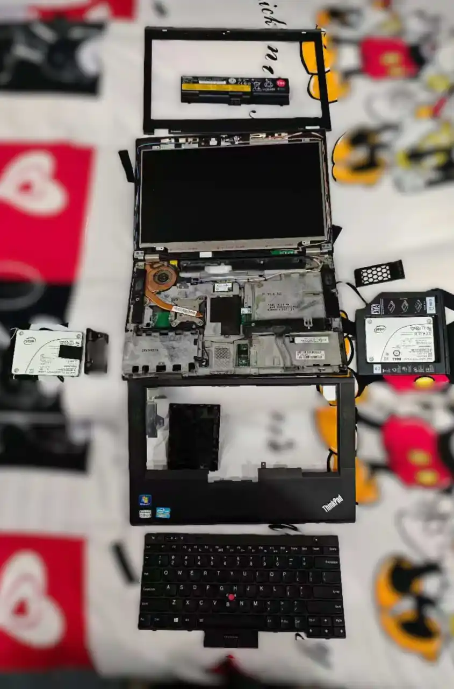

顺便一提，T430 内存盖板和硬盘盖板上的螺丝，都是防丢设计。所有的螺丝都是十字 + 一字的组合，兼顾了十字螺丝省力和一字螺丝不易拧花的优点，这对于旧电脑非常重要呢！有的机器拆了一半，发现螺丝拧花了，最后只能暴力拆除，就很烦人。

## 玩机：两个时代的串联、两种体系的碰撞

### CRT 电视爱好者

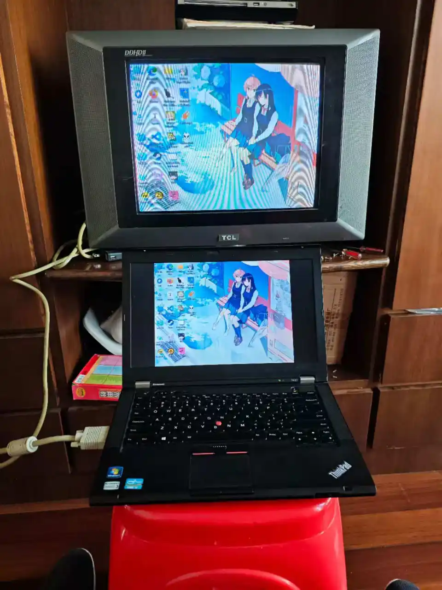

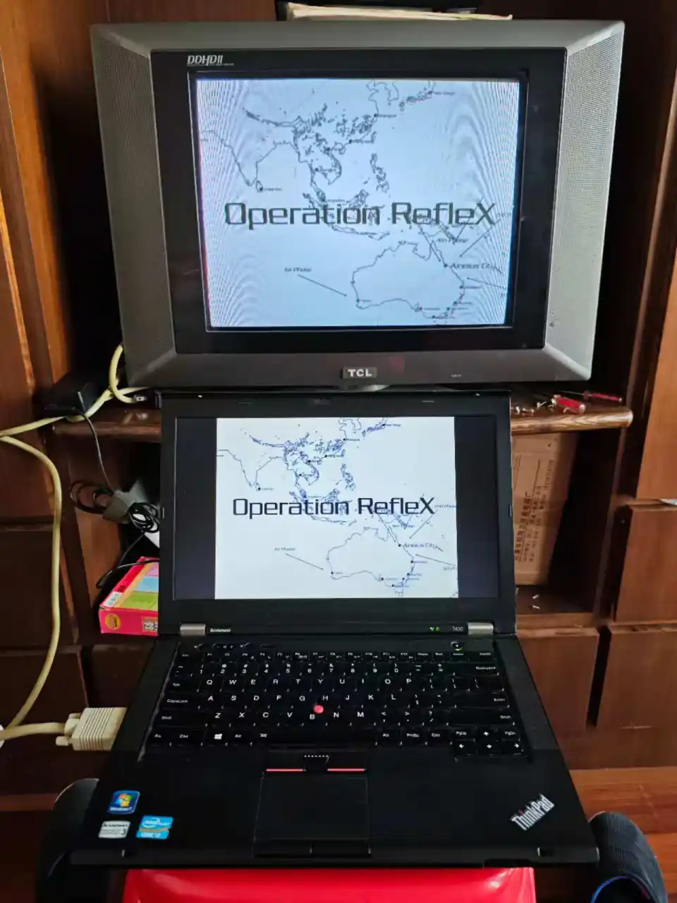

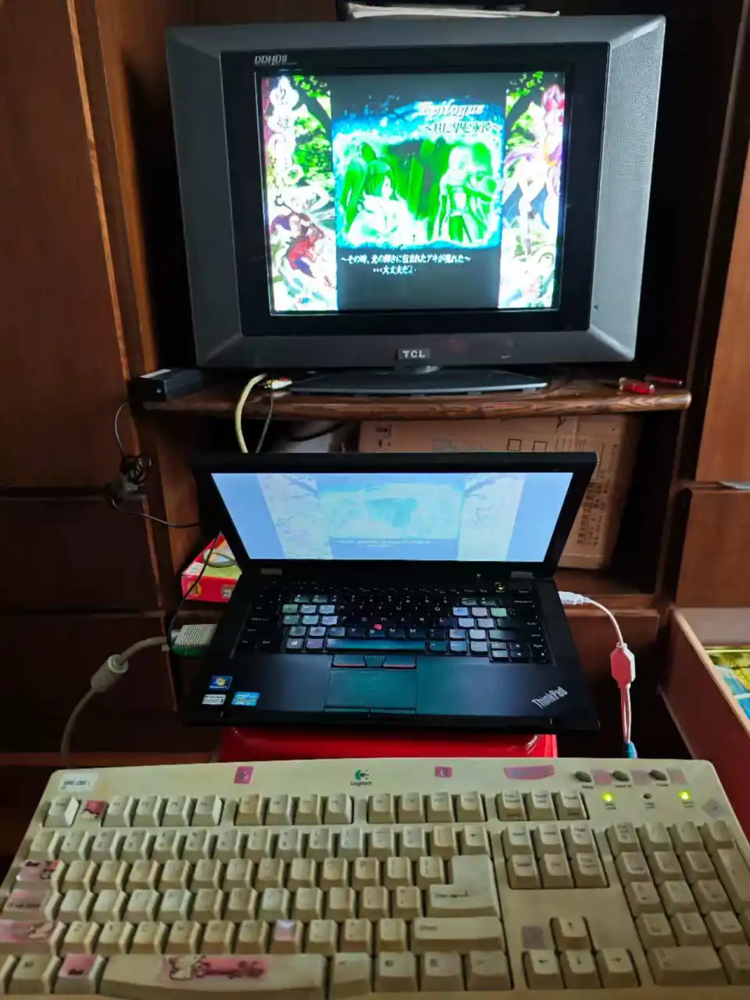

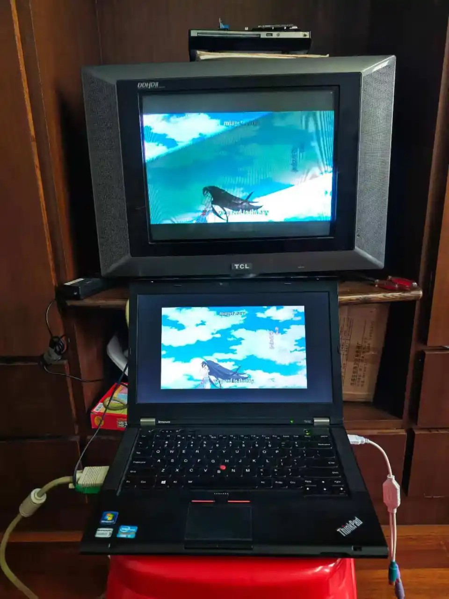

实际上这个部分与 T430 没多大关系。不过我更好的电脑不支持输出到 CRT 电视，其他能输出的机器配置也不如 T430，这时候 T430 就是我怀旧的最佳选择了呢。

小时候就是在各种 CRT 电视环绕下长大的呢，所以对 CRT 有莫名的亲切感。

### Black Apple（~~某种意义上是不是能叫做 “Bad Apple” 呢~~）

如果说，ThinkPad 是“黑色高级笔记本”的话，那么 MacBook 是“白色精致笔记本”也很恰当呢。那么，给 ThinkPad 赋予 MacBook 的灵魂，一定很有趣呢！从古至今，大家果然都很喜欢 NTR 呢~（\^ _ \^）

#### 偷懒失败

闲鱼之前看到一个卖黑苹果硬盘的，即插即用，于是买了，结果没用。和卖家排查了半天，也不清楚原因。

最后还是我一一问 AI 解决的，某种程度上来说，在这之后，我就比他更懂黑苹果了呢。

最后也不好意思退货，320g 的 HDD 也不知道有什么用。不过是苹果原装的硬盘，上边还有 Apple 的标识，勉强有点收藏价值。

#### Open Core 与 Clover 之争

卖家给的引导方案是 Clover，然而 AI 表示 Clover 已经过时，Open Core 才是更现代的方案。既然卖家解决不了问题，那我就果断放弃 Clover，All in Open Core！

这个时候，学会了使用一个很关键的软件——DiskGenius。平时分区都直接用 Windows 自带的磁盘管理，所以没怎么碰过 DiskGenius。不过这次涉及到 EFI 以及引导系统的更改，不得不用了。

#### 网卡悖论

EFI 对于黑苹果的安装至关重要。好在 ThinkPad 社区有大量 T430 的 EFI 提供下载，找了个和自己配置差不多的下载即可。（中间其实被 AI 坑了好几次，似乎数据库没更新什么的，推给我的版本都不合适，最后还是我自己搜索引擎找的）

配置方面直接使用 OCAT，刷写启动 U 盘用的 TransMac，用 Makeinstall 下载 Max OS 10.15（苹果官网下载，速度极快），似乎一切正常进行？

看着苹果加载条走完，中间没有报错，成功进入安装界面，心里是很安心呢。什么？安装过程需要联网？但是我的黑苹果网卡没有被识别哎？家里也没有通有线网络。

试了手头的所有 USB 网卡，全都不能正确识别。也尝试通过其他机器与 T430 通过网线连接，间接上网，结果突然发现人家连以太网都不认。

AI 提示在终端输入一串代码可以跳过联网，但是啥用都没有。从此事情搁置了好几天。

#### 洁癖的代价

突然想到，那个著名的黑果小兵的 Mac OS 镜像分享站。抱着试一试的心态替换了他的镜像，结果直接成功了？！

之前一直追求纯净系统，所以坚决不用别人的修改系统，要修改也是我自己魔改。这次属于是被自己的洁癖坑了。果然，大佬终究就是大佬嘛。

注入三码之后，伪造 Apple ID，之后，就能用啦。

#### 你的下一台 MacBook，何必是 MacBook！

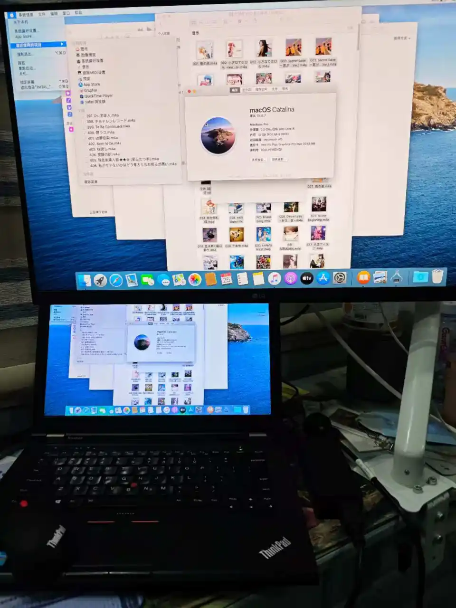

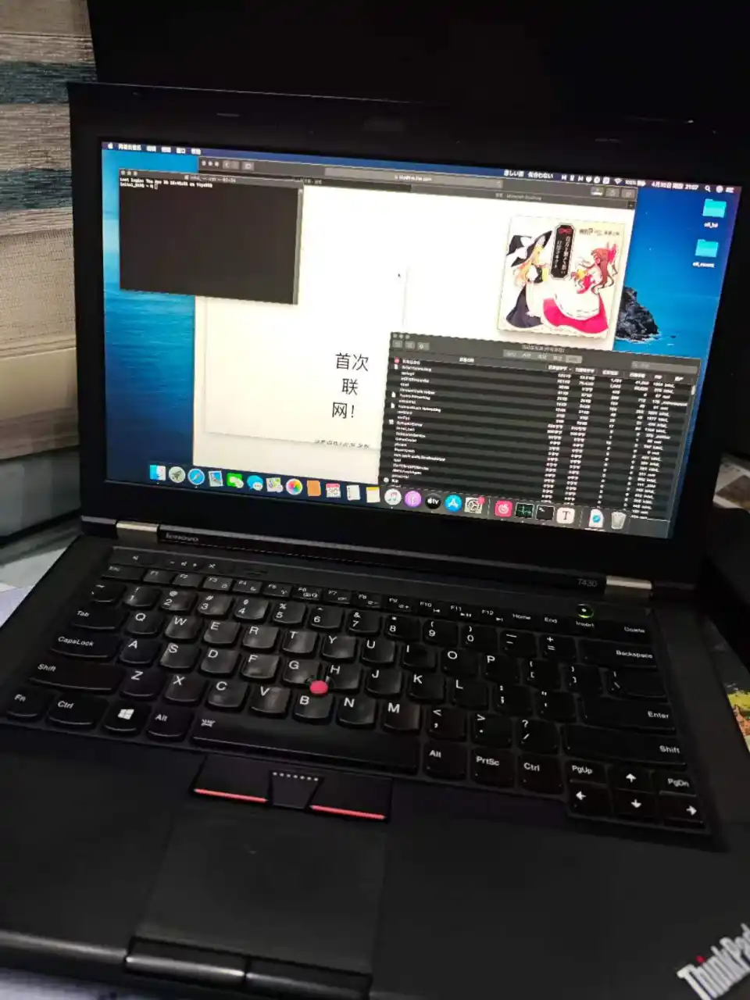

现在是黑苹果的大好时候呢，各种方案都非常成熟了，像我这种一窍不通的小白也能靠着 AI 摸石头过河呢。然而现在也是黑苹果的末路，毕竟苹果放弃 Intel 之后，顺便也给黑苹果判了死缓。

10.15 几乎不能从 App Store 下到任何支持的软件，唯一能用的也就一个网易云音乐（这个真是传奇兼容王，Windows Phone 这种冷门玩意儿能用）。怎么说呢，各种方面都非常不习惯吧，操作逻辑觉得怪怪的。

不过不得不说，苹果系统的资源占用是真的少，开机 1g 内存都没用到。

怎么说呢，总觉得乐趣全在折腾的过程中，成品反而有点索然无味了。没有软件的操作系统，充其量不过一个玩具罢了。

### Arch Linux 之旅

#### 拱门还是箭矢？

~~如果说 Debian 是蓝粉白（*xyn*）专用操作系统的话，那么 Arch Linux 就是小众嘉豪专用系统了。~~

不知道什么时候开始，安装 Arch Linux 就变成一种所谓“嘉豪行为”了。实际上，从小学到初中，再到高中，沉迷于安装和体验各种操作系统的人可真不少呢，我就是看着这些人，学习着这些人长大的呢。

或许在很多专业人士眼里，就是安装个系统而已，根本没有什么技术含量。但对于一个小白来说，一次完整的系统安装流程可以让他学到不少知识呢。而且只需要一次，其他就可以以此类推。你可以说他们浮于表面，但是从 0 到 1，实际上就已经超过不少人了呢。

实际上在高一的时候，就用 WSL 装过 Arch Linux 吧。实际上照着 Arch 那详尽的手册，以及各种博客，是很容易抄作业的。不过虚拟机到底没意思，整个实体机才刺激呢。

那为什么突然想着要给 T430 上 Arch Linux 呢？首先，之前已经给 X60 和 X61t 装过 Ubuntu 了，想换别的试试。其次，ThinkPad 对 Linux 的友好驱动环境是出名的，我之前两台也是即装即用，根本不用操心。

不过最主要的是，我之前一直看的一个 UP 的视频 [每天安装 Arch，直到我找到对象](https://www.bilibili.com/video/BV1cmNGzqEzt/?spm_id_from=333.337.search-card.all.click&vd_source=b332b2aaf83ea79674f90ade06bcfad8) **竟然完结了**？！不是同志，这是能完结的东西啊啊啊！你完结了我看什么啊喂！

说好的装一辈子的 Arch Linux 的来说！

不会是大肥鱼吧？你绝对是在骗我！~~你是有多精通面向对象的编程语言啊！~~

那还说啥了，Arch Linux 启动！

#### 谁用 Arch Install 啊！太没仪式感了

殊不知，Arch 此时已经有了像 Ubuntu 一样傻瓜式的一键刷写安装。Arch 的高级感一下子褪去了几分。不过，既然要表达对 Arch 的虔诚，那当然是要手动安装啦！

怎么安装的来着？直接查 AI 吧！

实际上，你会发现，TUI 界面手动安装和 GUI 界面自动安装，流程上也是差不多的。无非分区，挂载，安装，选择语言，创建账户一类的。只不过把鼠标点击换成命令行操作了。

装好后，没有自带 GUI 界面。既然 Wayland 挺流行，那就这个吧（尽管我觉得 Xfce 对于这种旧机器更友好）。

Wayland 的 UI 确实很现代呢，不过，放在 HD4000 上，确实有点不太丝滑。CPU 和内存基本没什么负载，压力全在集显上。

#### Black Apple 埋下的暗雷

之前不是更换了博通的网卡以支持黑苹果嘛，所以 Linux 就不能原生认卡了。本来以为装下驱动即可，结果各种 bug，搞到最后还是妥协，直接用我那张 Linux 免驱 USB 网卡得了。（这张网卡真是我折腾各种设备的 MVP 了，基本上这张卡都支持不好的，别的卡就别想认了）

反正黑苹果也尝鲜过了，要不改天干脆换成 AX200 得了。但是拆 T430 还挺麻烦的，起码得折腾个 15 分钟。

这下真成 Bad Apple 了。

#### Deepseek Harness 的小家

之前就想过在虚拟机上部署 DSH，现在有闲置的实体机了，岂不是更好嘛！不过 USB 网卡的 Wifi4 确实是个短板，连接不是特别稳定。

## 感悟：对于未曾经历时代的臆想

虽然小时候经常和电脑打交道，但是真正研究电脑配置，感受装机的快乐，实际上也就初二左右。

也算是一路看着老弟一号之类的 UP 长大，了解各种东西的。不过，大家总说，DIY 的黄金时代已经过去了，那个电子产品百花齐放的时代已经过去了，现在的产品很没意思等等。虽然没有亲自组装过那些年代的机器，但好歹也用过不少，说实在的，所谓“创意”，在如今趋同的“最优解”下，实际上不过是过去的一种妥协罢了。

但是，我依旧对那个年代有着一定的滤镜。我曾经处于那里，虽然我没有真正触摸；如今我远离那里，但那里的种种又伴随在我身边。

在我出生前，ThinkPad 就易主 Lenovo，漂亮的三色标变为一条银色的字母。然而，我又在 T430 上体悟到了 Classic ThinkPad 的魅力，体悟到了 DIY 的乐趣，虽然这只是一台笔记本。

真的，这台笔记本，有种，在各方面都毫不妥协，在各方面都宣示着“还能再战十年”的感觉，虽然充满了种种妥协：
- CPU 不够用？换 i7-3632QM 或者 i7-3740QM，瘦死的骆驼比马大
- HD4000 跟不上时代？在有限的 Express Card 带宽下，上 GTX 1060，虽然有 70% 的性能损失，但面对主流大作，依旧“能跑”
- 网卡不行？破解白名单，直接上 AX200 等现代网卡。
- 屏幕素质不行？实际上 1080p 只是最基础的改屏方案。改 2k 16:10 的也大有人在，只不过要对屏幕边框做一些切割改造
- 存储不够用？最高 4 盘位，直接化身移动 NAS

是的，每当其原有的性能跟不上时代，总是有“勉强能用”的改进方案。也是很意外呢，台式机式的升级，竟然让我在一台笔记本上实现了。

虽然这种改装毫无性价比：改了半天，性能接近 T480 了，但是价格也直逼 T480 了。总体来说，T480 是更加现代的选择。而且 T480 也同样是 ThinkPad 发展中一个时代的落幕，在圈子里的地位不输 T430。改天有兴趣了还是会考虑收一台的。

## 是什么成就了 Classic ThinkPad？

当然，Classic ThinkPad 的各种优秀设计是其一；优秀的企业服务与优秀的品控也是其一；IBM 蓝色巨人的滤镜也是其一。但这不足以使得 ThinkPad 如此受人追捧。要知道，HP 和 DELL 也有类似定位的机器，也有一定的爱好者群体，但都不如 ThinkPad。

某种程度上，或许可以把 ThinkPad 理解成笔记本界的东方 Project 呢。正是 51nb 之类的社区中，各类大佬的探索，才造就了如今 Classic ThinkPad 的生态：
- 想要装黑苹果的 EFI？有人做好了各种配置的。
- 想要破解白名单？有人做好了用 U 盘就可以刷写的程序。
- 想要升级屏幕？有人设计好了转接板。
- 觉得 20v 圆孔太笨重了，想换 Type-C？有人设计了相应模块。
- ……

除了对于原机的小修小补，我还见过那些大刀阔斧的改造升级：就以 X201 为例。从 X210，到 X2100，再到如今 Ultra 处理器的 210AI，我真的从来没见过如此一台老机器，会重生这么多次。虽然很多人说“卖情怀”之类的，但是要知道，设计主板，生产主板，对于这种小批量的定制产品来说，是很难回本的。有时候真的不得不感叹人的执着。

一台优秀的机器，运行在复杂的环境，受到人们的尊敬。

一台过时的机器，流浪到单调的如今，不过一代“时尚单品”。

一台经典的机器，飘荡到怀旧的群体，掀起一波“复古”浪潮。

一台伟大的机器，跨越岁月，几经转手，依旧有人为之改造，只为使它依旧能在各种领域发光发热。

如果说，同人创作成就了东方 Project。

那么，一代又一代的 ThinkPad 使用者，造就了 Classic ThinkPad 的伟大。

Make ThinkPad Great Again!

完结撒花~