## 对正统 IBM ThinkPad 的执念

虽然手头有带 IBM 三色标的 ThinkPad X61，但那毕竟是 Lenovo 时期的机器，总觉得还不够正统。

要再正统一点，那就要看向 X41 以及之前的机器了，那些才算最后一代 IBM ThinkPad。

话虽然这么说，不过很多人都说，末期的 IBM ThinkPad 可能是马上就要卖给 Lenovo 了吧，所以各种设计都不怎么上心，偏向于保守。不过这一份保守，对于今天的收藏者来说，却又是独一份风景了呢。

不得不说，虽然大家对于 Lenovo 有种种不满，但 Lenovo 时期的 ThinkPad 确实相对 IBM 便宜了不少。从存世量来说，X60/X61 相当多，二手价格也非常便宜。相对来说，X30/X40 的就要稍微贵一点，而且成色看运气。所以很长一段时间，我都是观望状态。

## 捡漏？！

然而，在去年 8 月，我却看到了标价 130 元的 ThinkPad X32？！本来都没怎么注意，觉得这种机器嘛，肯定是故障及拿来骗人的啦！

转头一看封面图，屏幕是亮着的，能进桌面？那可能有点小毛病，不过整体上来说问题不大吧？

小问题还是有的，就是键盘 PCIMIA 卡插槽处缺了一块，不过这也是通病了，在没插拓展卡的情况下，确实很容易把那一块压断。还有就是日版机器，键盘布局对于我们这种用惯美式键盘的人来说非常反人类，不过键盘这种东西更换非常方便，也不成问题。

还有就是 CMOS 电池没电，以及操作系统不稳定，都是好解决的小问题，不在话下。

是个人卖家，而且还是真正的曾经的使用者，还是非常难得的。一般卖这种的不是二道贩子就是收藏爱好者。真正曾经的第一使用者，基本上很少会低价出那些曾今自己花大几万买的东西的。也算是运气相当好了。

对于一台 2003 年的笔记本来说，最需要顾虑的应该还是屏幕。不过看图片，屏幕亮度非常好，也没有霉点、老化发黄等老 LCD 显示屏的通病。还有一个就是电池续航，不求能用几个小时，有电就行，问了下，结果是能用。那还说啥了，直接拿下！

邮费 12 块，不算贵。卖家还送了个鼠标，可惜中途快递似乎丢了，最后没拿到。

也是在闲鱼上非常愉快的一段捡漏体验了。

## 配置

### 电池——完好如初

与往期不同，我首先真就要说一下这逆天的电池！2003 年的机器，电池能用 2 个小时？！

X32 的电池真就不是贵的问题了，这是根本买不到好吗！真要只能找人定制的！

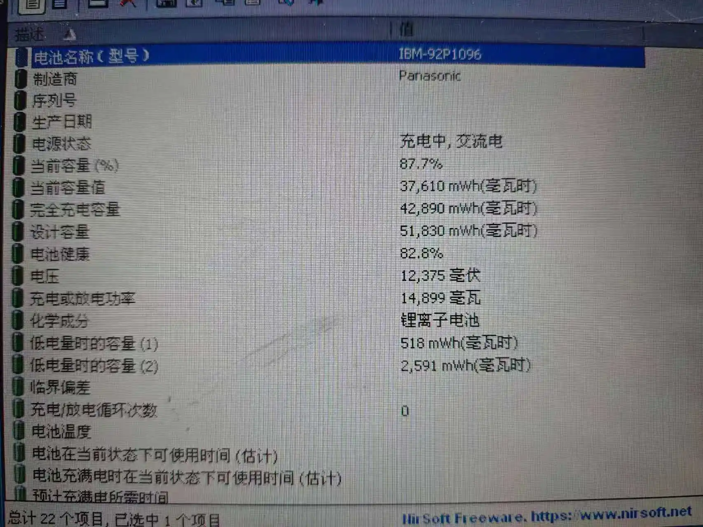

### 屏幕——完好无瑕

1024 * 768 TN 屏，但是保养相当好，几乎没有任何老化，亮度也和新的一样。面对我那台屏幕老化的 X61 是降维打击。

甚至这台机器贴膜都没撕，非常少见的成色啊。也算是捡漏的一个点了。

### 键盘 & 更换键盘

#### 布局别扭，功能有损的日文键盘

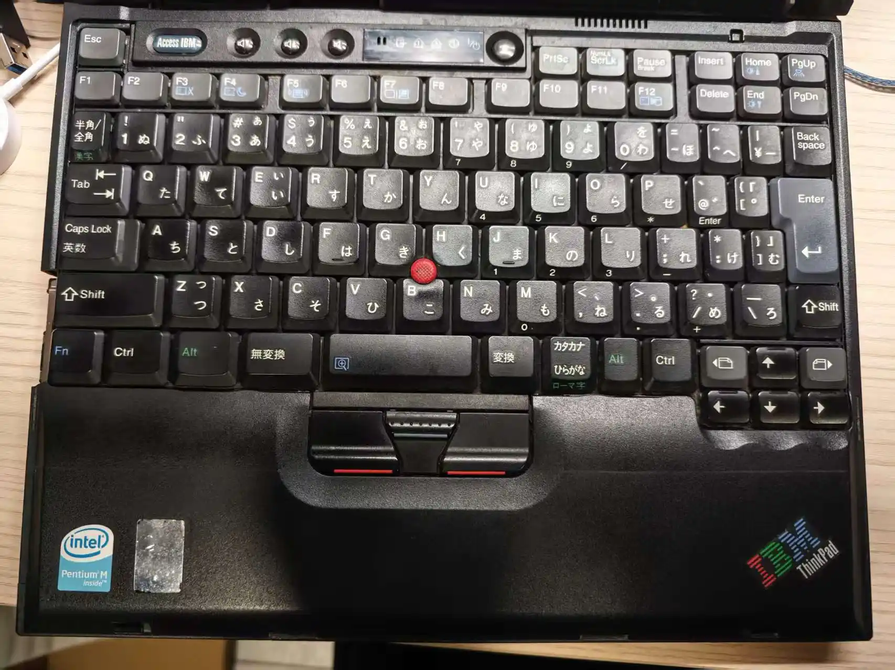

还有一个重头戏就是键盘。同样是七行键盘，不同设备，不同成色，手感还是有天壤之别的。

一开始拿到的是日文键盘，布局非常难受。而且`I``K``F6`键都失效，就非常难受。`I`和`K`的失灵尚且还可以忍受，能用屏幕键盘拿鼠标戳。但是`F6`是 BIOS 更改必用的键，而 BIOS 界面当然没有屏幕键盘给你戳了。那剩下的选项就只有外接键盘了。

不过，不管怎么说，键盘损坏的 ThinkPad，特别是键盘损坏的 IBM ThinkPad，那绝对是没有灵魂的，忍不了！

#### 拆机 & 键盘更换 & CMOS 电池更换

CMOS 电池没电了，不过新的 CMOS 电池很好买，而且很便宜。

拧下内存插槽盖板，边上就是 CMOS 电池位，更换也很方便。（同时螺丝的防丢设计以及十字一字双保险设计好评）

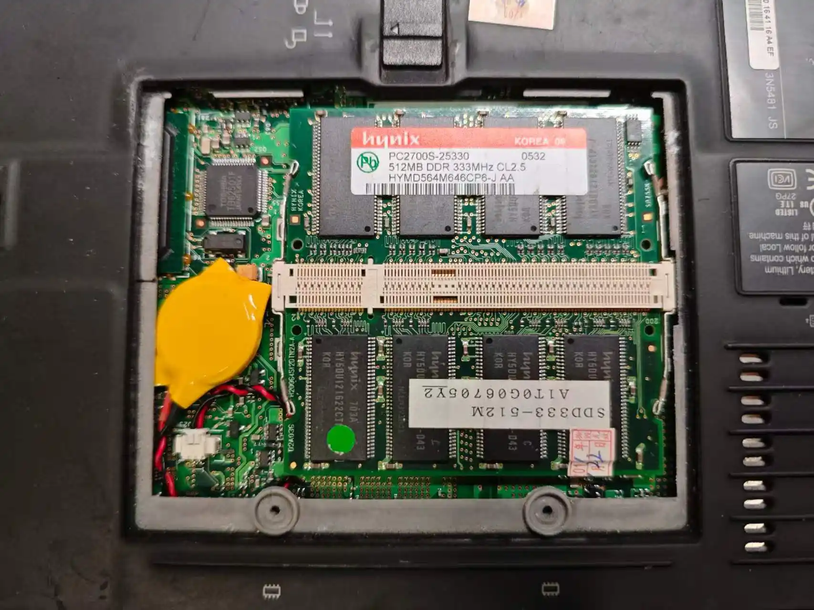

原有 CMOS 电池是用强力胶固定的，二十多年过去，依旧十分牢固，废了好大劲才拿下来。

拧下所有标有`键盘`标志的螺丝，再轻推键盘，即可取下。（注意那个有保修贴的螺丝，把`键盘`标志给我遮住了，以至于一开始键盘怎么都取不下来，坑了我一道）

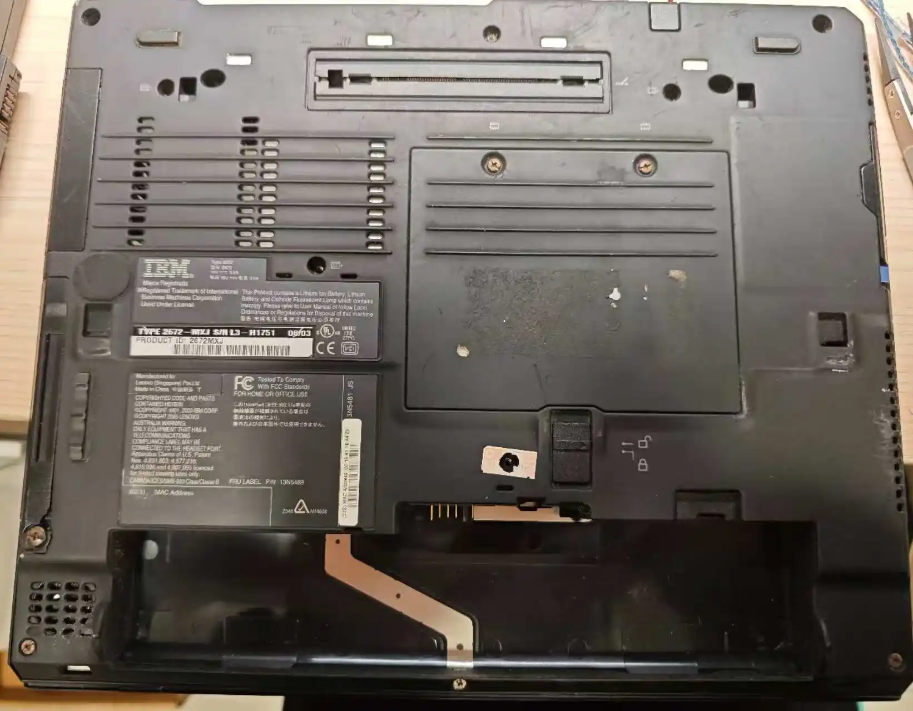

既然取下键盘了，就不放看看机器内部结构吧。

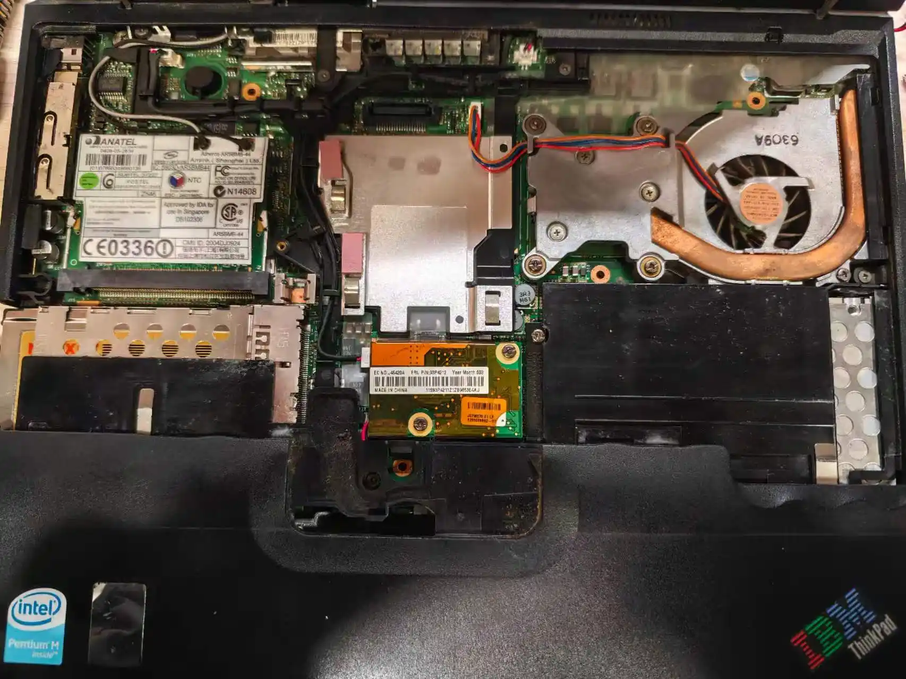

左侧那张超大的无线网卡是真的没想到的，直接就一张 mini PCI，非常震撼。中间用铁片散热的应该就是 ATI Mobility 亮机卡，右侧为 CPU。上侧是指示灯的LED导光装置（知道为什么键盘指示灯这么好看了吧）。

不得不说，IBM 的机器，内部做工确实非常不错的。走线也非常规整。

#### 第一次拥有全新的 ThinkPad 键盘

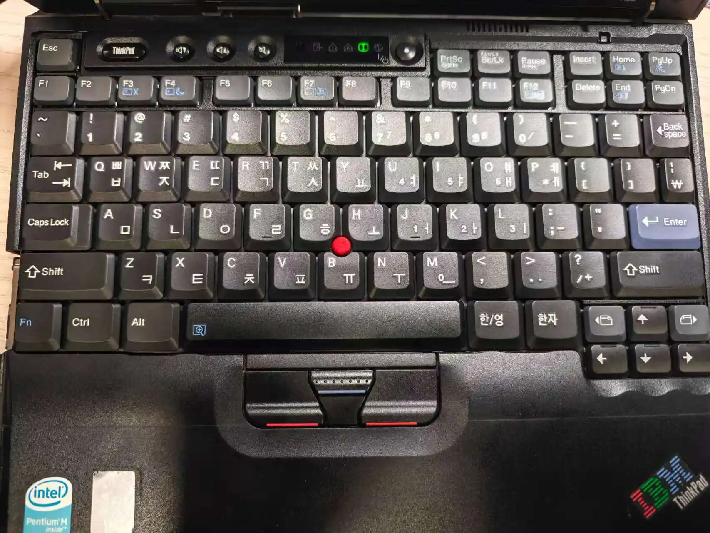

X32 键盘卖得不像 X61、X200 之类的烂大街，不过也是有的，价格也不是特别离谱。不过就是找不到标准的美式键盘。

不过经过对比搜索，还是找到了一把和美式键盘布局相似的韩文键盘，唯一的区别就是增加了一些韩文字符而已，平替完全没问题。50 包邮，价格上也可以接受。

本来吧，对于键盘的需求，就是能用就行，成色之类的，不强求。不过到手那一刻，我人都傻了：什么叫你键盘灯的膜都没撕的全新键盘才卖 50 啊？！

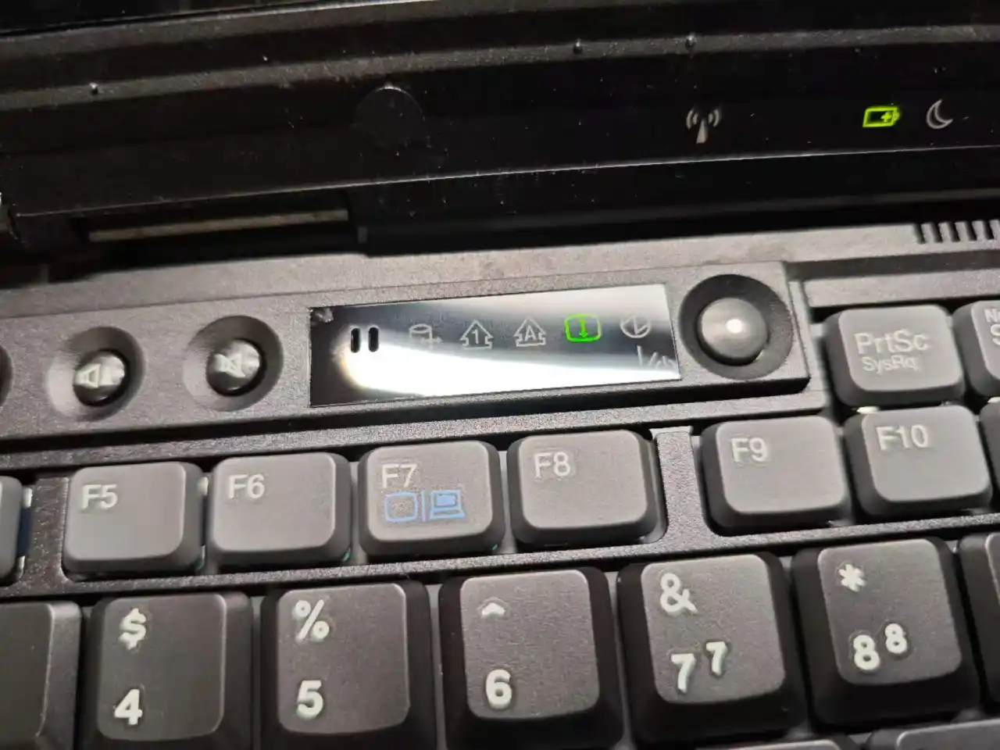

收的 ThinkPad 也不少了，不过二手机，键盘多少会有点打油、积灰。这时候拿到一把新得发亮的 ThinkPad，那可是相当惊喜啊！

不愧是全新的键盘，手感相当好，是我目前用过的，手感最好的笔记本键盘。

对了，不知道有没有看到键盘右上角的小方块。如果你注意到屏幕同一位置有一块突起的话，你大概就理解这个小方块的作用了。（没错，就是判断机器是否合盖）现在的电脑很多都是靠着光纤传感器和霍尔传感器之类的判断的，相比之下，这台二十多年前的电脑给出的方案倒是简单粗暴有效。

### CPU

Pentium M 1.7GHz 单核处理器，在当时应该算是中规中矩吧。最高配能到 2.0GHz，不过估计那个规格散热也是问题。

离电状态降频严重，很多时间都跑在 600MHz，离电基本只能写写文档了。

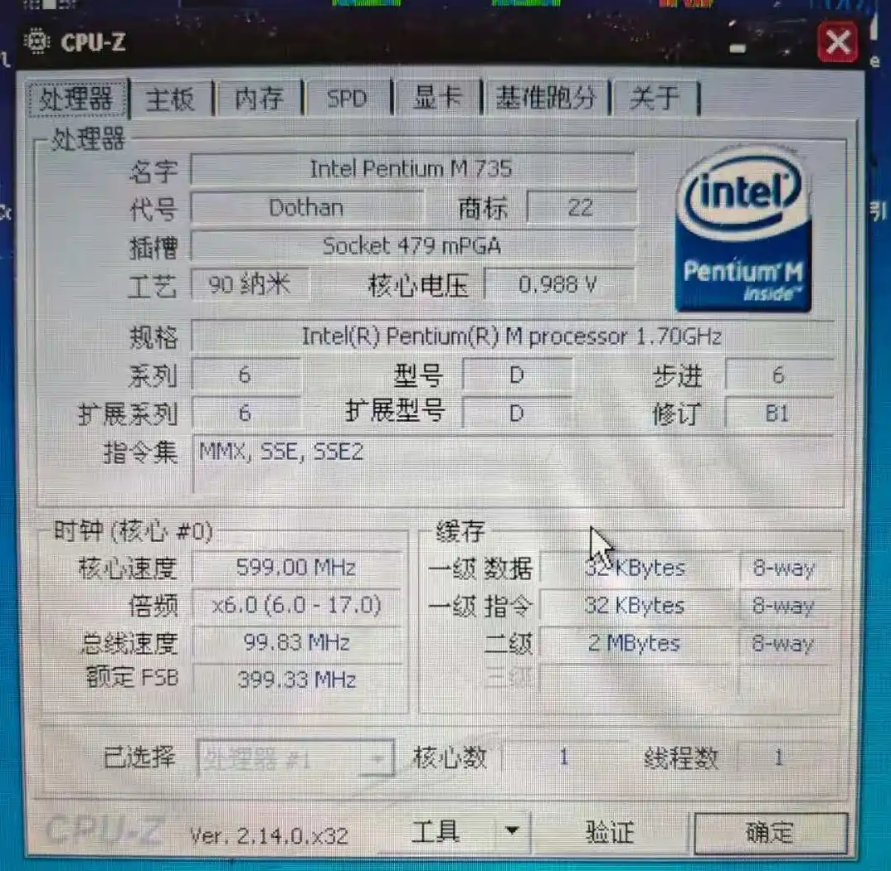

不过，不管怎么说，CPU 绝对不是这台机器的瓶颈。

*但不知为什么，CPU-Z 的跑分相当离奇，单核 1.4，多核 1.0，肯定是有问题的，这里就不贴出来了。（长这么大头一次见多核分数比单核低的）*

### GPU——为什么打红魔乡都会掉帧啊！

现在听到“独立显卡”，那可是高端的代名词。不过，在以前的笔记本电脑上，很多时候 CPU 是没有集成显卡的，独立显卡就承担了亮机的任务了。

这台电脑搭载的 ATI Mobility Radeon (M6) 就是这样的芯片——在那个时候，是打不过 Intel 的高端核显的。（不过，今年 Intel Arc B390 核显也超越了 Nvidia RTX 3050，也是历史的重演了）

#### 游戏能力

不过，怎么说也是独立显卡，拥有 16MB 的~~海量~~独立显存，不用单独分走内存。在那个内存寸土寸金的时代，还是有一定意义的。支持 DirectX 7 和硬件 T&L （几何变换与光照），也能模拟运行 DirectX 8/8.1/9c，如果只是要启动老游戏的话，兼容性还是很不错的。

玩 DX8 游戏《GTA3》实际上能有 15-30 fps，现在看可能不够，不过 XP 时代人们对于游戏帧数要求普遍不高，20-30 fps 基本上都是可以接受的。

不过同样是 DX8 游戏《东方红魔乡》，情况就不太一样了。纸面参数上，这块显卡完全可以无压力运行。但实际上，毕竟不是硬件支持 DX8，所以打 EX 等弹幕比较多的关卡的时候会掉帧到 40fps 左右，是不能全程 60fps 运行的。

对于要求在 DX7 及以下的游戏，基本上都是没有压力的。用模拟器玩 PS1 游戏也是非常流畅。

#### 影音能力

这一点实际上是 GPU 和 CPU 的综合能力考验呢。

视频解码能力极差，基本上只能解早期 VCD。有时候碰到画质好一点的 DVD 都是生死局。

音频解码能力上，拿 PotPlayer 播放 flac 完全就是一场酣畅淋漓的性能释放。基本上放着就不要想做别的事了。

不过，我承认，在这种老机器上，老板的 PotPlayer 或许并不是最佳选择。

### 内存

DDR 内存，原配一条 512MB，后来又加了一条 512MB 组成 1GB。

虽然最大能组 2GB，不过考虑到 1GB 的 DDR 内存不好找，还是算了。

### 硬盘

原配 40GB IDE 机械硬盘。可以选择买 mSATA 转 IDE 的板子上固态，不过个人觉得没必要。Windows XP 在机械硬盘上运行已经很流畅了。

### 网卡——外星科技！

#### 无线网卡

硕大的 Mini PCI 网卡 Atheros 5213A (AR5BMB-44) 。理论最高 108Mbps，标准模式 54Mbps，802.11b 模式下最高 11Mbps。

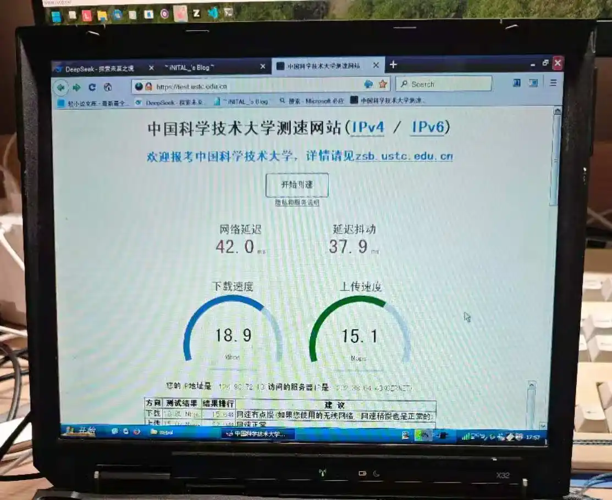

速度相当可以，别看纸面参数一般般，但是稳定性还是相当好的。

#### 有线网卡

Intel **千兆网卡**？！你要知道时至如今，都有很多低端机型有线网卡给不到千兆的。我家也是去年才有的千兆网。在 2003 年这纯属外星科技啊！

但是，这台机子 CPU 解析，以及 HDD 读写，实际上能跑满百兆就不错了，这种堆料稍微有点不明所以。联想到 ThinkPad 打工人的定位，需要企业间传输大文件，又觉得挺合理的。

#### 调制解调器

这个没细看，以后如果有时间和家里有调制解调器的台式机组个局域网或许挺好玩的。

### 扬声器——听个响

依旧梦幻单扬声器，布局还在角上（参见`拆机`部分的图片），不过个人觉得音质还是比 X61 好一点，至少不至于爆音。

### 接口——复古玩家的极佳中转站

接口非常全，说是微型的接口博物馆也不为过：

- USB 2.0 * 2

  其中只有一个供电充足，能外接移动机械硬盘。其他只能接 U 盘、键盘、鼠标等低功耗设备。
  
- VGA 接口
- RJ-11 拨号网口
- RJ-45 **千兆**网口
- **并口**

  可以拿来玩老式打印机

- **CF 卡读卡器**

  很多 2000 年左右老式 PDA 都会拿 CF 卡作为外置存储。不过在 2003 年这个节点 PDA 都相继改用 SD 卡了，在当时显得稍微有点落后。不过在现在反倒显得实用了（毕竟家里没有别的 CF 卡读卡器）。

- PCMCIA 接口

  目前拓展了一张 USB 2.0 * 2 的卡（没错，就是 X61 坏掉之后，剩下的那张）。

- 1394 火线接口

  和 CCD 相机传输数据的高速接口，可惜手头祖传的 CCD 相机老早坏了，不然可以体验下。

- **红外线接口**

  可以拿来和 PDA 传输数据，还是很好玩的。也是我目前唯一配备红外线接口的电脑。

- **3.5mm * 3 圆孔**

  三个圆孔，三种颜色，对应 IBM 三色标，是非常漂亮的设计。

  分别对应：

  - 耳机输出
  - 麦克风输入
  - ==**线性输入**==
    这个接口一般只有台式机才会配备，很少见但是很实用的功能。

    能直接拿来采集 CD 播放器或者磁带机的输出信号（当然，理论上任何设备的输出信号都能采集），对于喜欢玩旧设备的我来说绝对是个优势。

### 拓展坞

#### ThinkPad X3 UltraBase——量身定做

X30\X31\X32 的专用拓展坞，也是目前买的拓展坞，价格非常便宜，70 块包邮。成色一般，不过功能度完好。

实际上拓展能力不大，装上之后会挡住机器后部的 VGA、USB 并口、RJ-45、RJ-11，因此真正附加的只有以下接口：

- 并口
- PS/2 接口
- 电池插槽

  没错，能再插一块电池，恐怖吧？

- 双扬声器
  
  对于原机的单扬声器确实是质的提升。

- **Ultrabay**
  真正的重头戏，能够拓展**软驱**、光驱、硬盘。

  硬盘托架还是太贵了，软驱价格还在接受范围之内，也就买了。

还有开机键，不过不像 X6 UltraBase 那样有防误触设计，这点差评。

#### ThinkPad Dock II (2631/2877)——力大砖飞

字面意义上的重型拓展坞，自带台式机电源，丧心病狂地提供了 **PCI 接口**？！也就是说，能外接声卡、网卡、电视卡、磁盘阵列卡等等，以及，**显卡**！

原来二十多年前就有这么优雅的外接显卡方案了吗？！

而且，2877 拓展坞更是还附带 2 个 PCMCIA 插槽，4 个 USB 2.0 接口，以及一个 DVI 接口。而且也有 Ultrabay 模块。

真正做到了固定位置台式机，移动场景笔记本的应用场景。这才是真正的全能本啊！

2631/2877 一直是我心目中的完美 ThinkPad 拓展坞，也是我认识的最疯狂的拓展坞，不过价格嘛——已经不是价格的问题了，根本买不到。（ebay 上倒是有链接，不过已经卖掉了，成交价是 100 美元，不包含邮费）

如果想要了解这两款奇迹般的拓展坞，以下两篇文章有详细介绍：

- [ThinkPad DOCK II 完全评测上篇：前言、外观和概述](https://zhuanlan.zhihu.com/p/406359624)
- [ThinkPad DOCK II 完全评测下篇：体验、评测与后记](https://zhuanlan.zhihu.com/p/406394223)

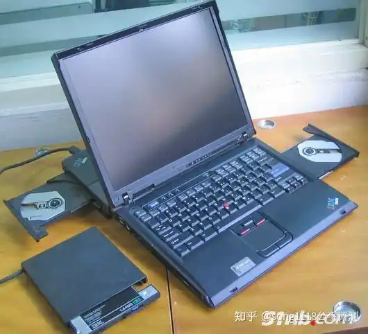

#### 端口复制器（2878）——实用主义

这个倒是没什么好说的，并不能额外增加接口。实际用途就是，比如说，在办公桌上，把显示器、键盘、鼠标、打印机接到端口复制器上，办公的时候把电脑放上去就行了。要离开公司移动办公，就直接把电脑拿下来即可，省去了反复插拔线的麻烦，还是挺实用的。

不过对于收藏者来说，倒是没有太大的吸引力呢。

## 安装 IBM 原版系统！

IBM ThinkPad 的一大特色就是专有的 Think 系列软件。在网友的分享下，下载了 4CD 的镜像文件，并刻录，然后一张一张塞进去安装。

也是非常独特的系统安装体验呢。一共花了我大概两个小时吧。不过实际上还是很省心的，CD 的内容也包含驱动程序和部分 Windows XP 补丁，省了后续找驱动和打补丁的时间了。

安装好后，还有一个额外的恢复分区，集成了文件管理器、Opera 浏览器等功能，在 Windows 不能正常启动的情况下，能转移文件并重装系统，可以看出其安全性上的考量了。

点击键盘上的`ThinkPad`按钮，弹出`IBM Access`专有设置菜单，还是非常酷的！（~~虽然 50% 的选项都用不着就是了~~）

## 第一次往 A 盘读写文件！

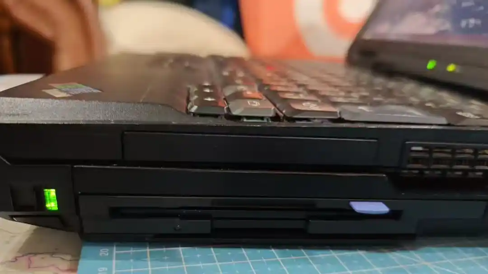

40 元包邮的软驱模块，不包好坏，本来没抱太大希望，准备换皮带的。谁知道即插即用了，也是非常惊喜了。也算一个小捡漏吧。

手头刚好有两张 1.44MB 的闲置软盘，其中一张还是 SONY（实际上也没什么稀奇的）。

觉得软盘读写的声音特别微妙呢。毕竟速度远远不如光驱和硬盘，所以声音频率就低很多，要类比的话，就类似于小轿车和拖拉机？

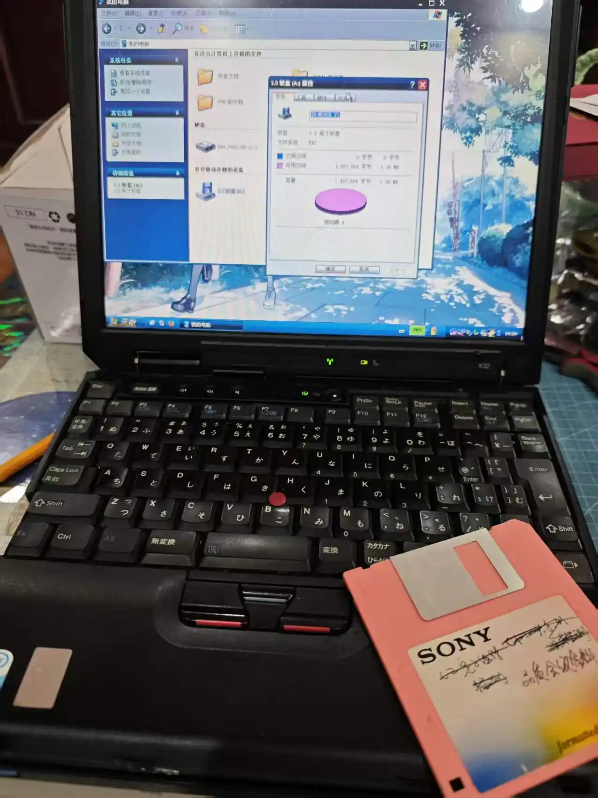

读写方面确实极慢，在软盘上存储一个 Word 文档，然后在上边编辑，基本上不可行。软盘仅仅只能作为文件的中转站。（当然，如果只是小规模`.txt`的话，还是勉强能胜任的）

没有任何实用性，不过，也是第一次在我的电脑中看到了`A 盘`的字样，也是独特的体验呢。

## 浏览现代网页！

有如此逆天的网卡配置，当然是要好好网上冲浪啦！

Firefox ESR 52 是最后支持 Windows XP 的官方选择，不过依旧有很多限制——最直观的一点，不支持`.webp`图片就足以给它判死刑了（浏览我的博客站，图片不能显示，样式无法加载，基本上只能看文字了）。也就几个页面比较复古的轻小说下载站能流畅查看。

IE 6.0 因为不支持 TLS 1.2，直接连都连不上。

最后还是选择了在 MyPal，基于 Firefox 68 对 Windows XP 等老系统以及老机器特别优化的浏览器。能应付大部分现代网页，而且性能开销也不大。

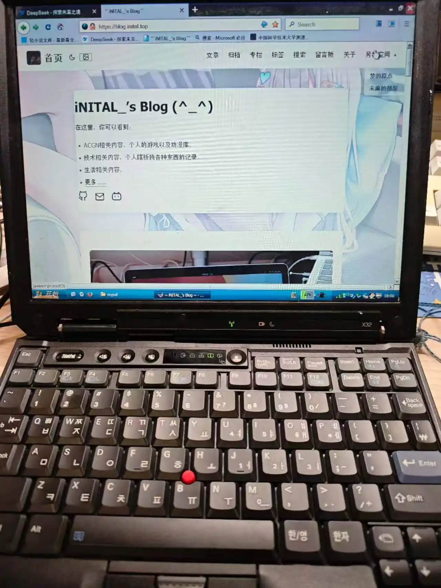

对于我的博客站，能正常加载图片，稍微微调下博客站兼容的`css`之后也能显示类毛玻璃的效果，还是非常满意的。

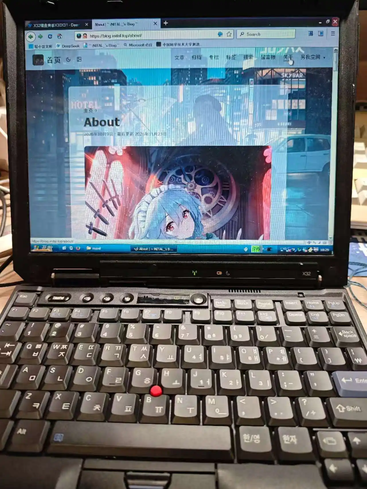

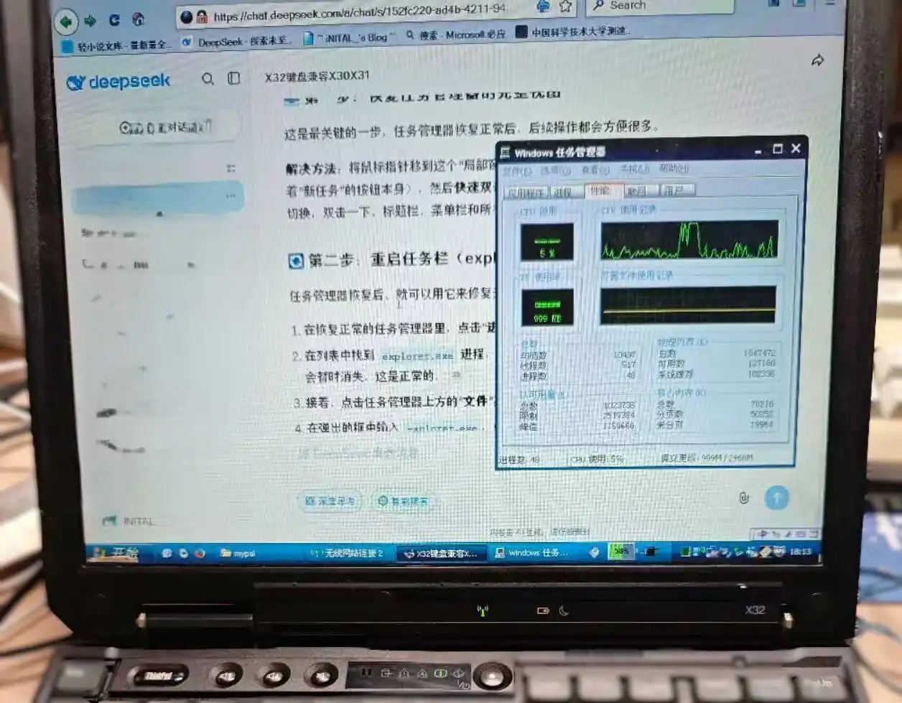

## 未完待续

实际上目前还没有写续篇的打算呢。但只要不被整坏，X32 还是会和我一起做各种各样的事情的呢。

敬请期待吧。