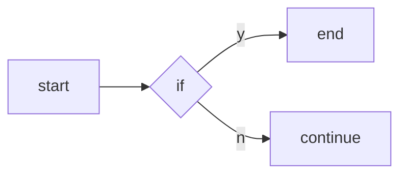

## Basic

This is a file to test the fearures of the markdown.

**Bold**，*italic*，~~delete~~，^superscript^，~subscript~，==highlight==，++insert++

- list without order
- ——

1. ordered list
2. ——

## Table

|   A   |   B   |   C   |
| ---- | ---- | ---- |
|   1   |   2   |   3   |

## Code

~~~cpp
#include <iostream>

int main (){
    std::cout<<"Hello World!\n";
    return 0; 
}
~~~

Inline code: `printf("Hello World!\n");`

## Footnote

footnote[^1]

## KaTeX

KateX in full line.

$$
E = mc^2
$$

Inline KaTeX: $A ^ 2 = B ^ 2 + C ^ 2$

## Mermaid graph

## Image

## 网易云音乐



## Bilibili



[^1]: Define the footnote
