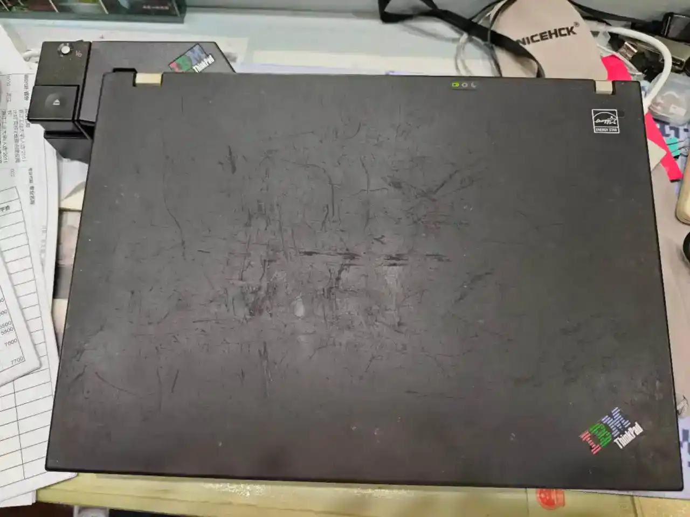
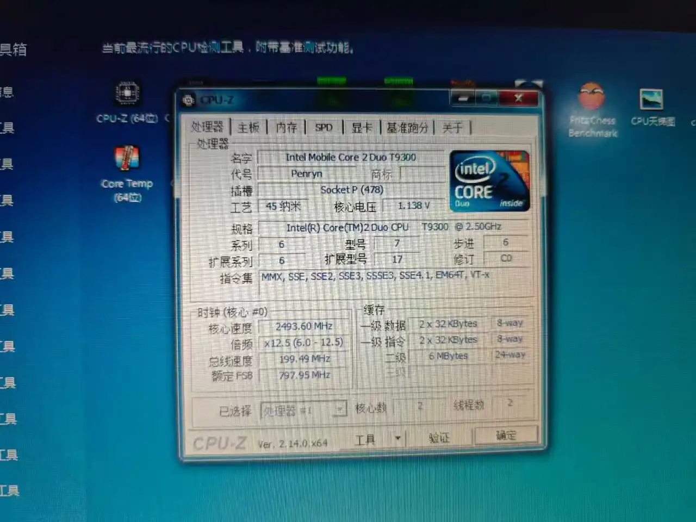
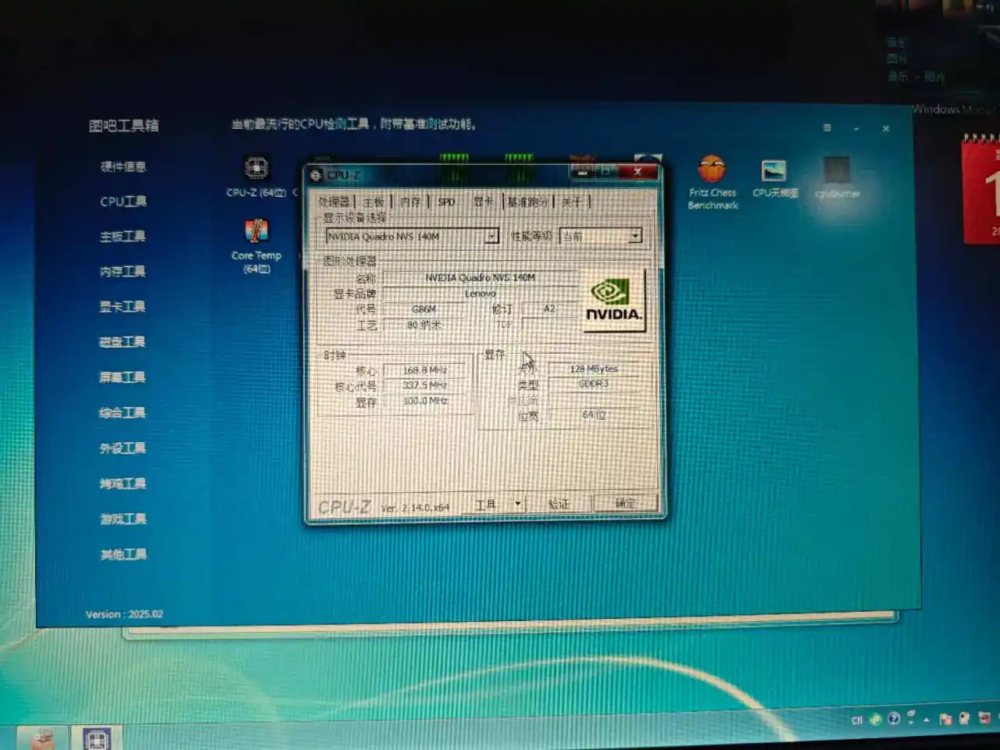
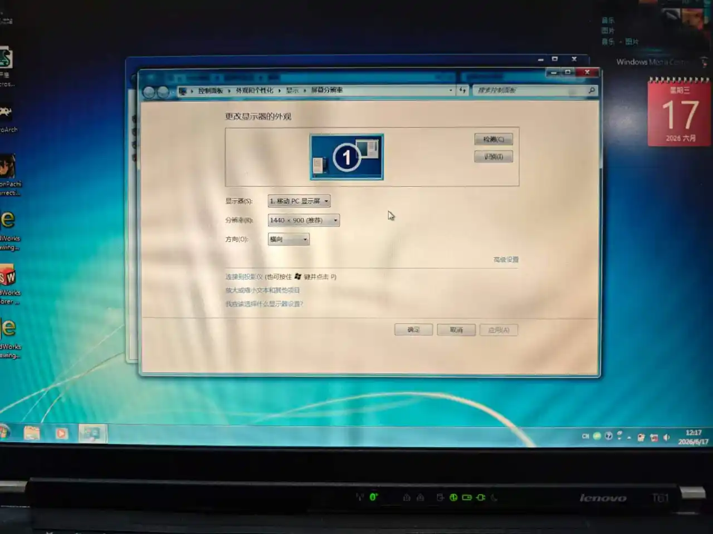
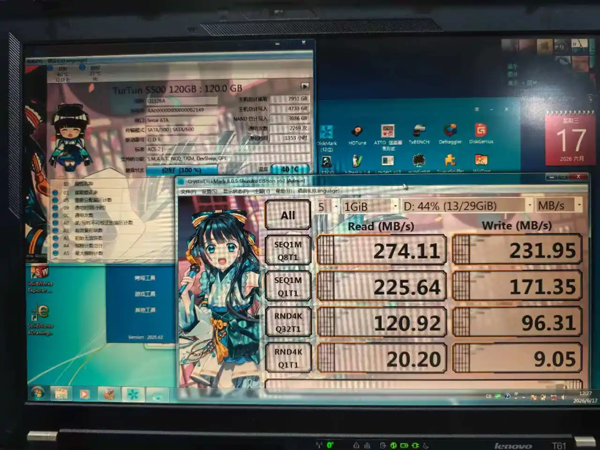

## 短暂的邂逅

这篇文章写好很久了，一直作为战略储备，错峰发布呢。

轰轰烈烈的垃圾站补完计划开始啦，这是第一篇！也是对于那些已经“清空回收站”的机器的一个纪念吧。

为什么首先更新 T61 呢？因为这是我所有收过的 ThinkPad 中，使用时间最短的。以 314 元的价格拍下（自带拓展坞，捆绑购买挺划算的），于 2026-06-03 确认收货，又于 2026-06-26 以 300 元的价格卖出，中间间隔一个月都不到。不过，毕竟是我高考前玩过的最后一台机子呢，还是有一定纪念意义的吧。

不得不感慨考前我心态是真的好，还有心思买电脑玩呢。

## 外观

也是最后一代 IBM 标志的 T 系列呢。运气很好，拓展坞和电脑都是 IBM 三色标。

## 配置

### CPU

Core 2 T9300 2.5GHz，算是顶级的末代酷睿 2 了，相当有力气。

查了下，单核大概 252，多核大概 476。怎么说呢，在单核上依旧不输那些五代六代的超低电压 CPU，面对多年后 T430 上的 i7 3632QM 也丝毫不虚（3632QM 单核 286）。但是多核确实吃了双核双线程的亏，没法看。

不过对比我之前同时代 X60 中 T7100 的单核 72，多核 144 那已经不能说是质的飞跃了，完全就是碾压。（顺便一提，X61 也有魔改主板的 T9300，甚至是 T9900 的版本，性能和价格上都是相当恐怖的）

### GPU

这个是我买这台电脑的一大原因呢。众所周知，在 08 年左右的 N 卡有著名的显卡门事件（特别是 G86M 核心），相当一部分电脑都遭殃。这一段时间的笔记本也是重大的坑点呢。不过这台机子是后期改进的，规避显卡门的版本，还是比较少见的呢。

Quadro NVS 140M，实际上就是 GeForce 8400 GS 的工业版，添加了对于 SolidWorks、AutoCAD 之类工业软件的专有驱动支持，其他性能和游戏卡版本类似。考虑到最新驱动也就支持到 Windows7，无奈，只好放弃了装 Windows10 的念头。

相对于同代的 X60 那个 X3100 核显，提升是明显的。东方 Project 全正作都能流畅运行，像是之前经常掉帧的 3D 同人 STG《苍空之雾》，在全高画质下也丝毫不虚。不过到了《苍空之雾 Remake》上就略显吃力了。

相对于没有 H.264 解码支持，CPU 性能更弱的 X60，T61 在高清视频播放上也流畅很多。能正常播放 BD 版的《魔法少女小圆》，对于一台 2008 年的机器来说，也很不错了。

显卡最后支持的 SolidWorks 是 2015 版，也体验了下，各种简单操作都很丝滑。至于复杂场景，我也不会做，也没法演示了。

不过，不得不感慨那时候硬件发展的飞速呢，三年后的 HD2000 核显就能和 NVS 140M 打得不相上下，HD3000 更是全面碾压 NVS 140M（除了工业设计软件方面）。

不过 ThinkPad 也从来不以强大的独显而闻名就是了，更多时候是牺牲性能来换取稳定性。

### 屏幕

实际上 T60 和 T61 的产品版本非常混乱，毕竟处于 IBM 和 Lenovo 的交接时期。光是屏幕就有 14-15 英寸 16:10 的 1680 * 1050、1440 * 900、1280 * 800，以及 14-15 英寸 4:3 的 1400 * 1050 和 1024 * 768。实际上 4:3 的收藏价值还是挺高的，毕竟是性能最高的一批 4:3 笔记本电脑了，拿来玩老 Galgame 或者看老番简直绝配，可惜数量稀少，价格也极高。我抽中这台为 1400 * 1050，属于中配。依旧那个年代的雷霆 TN 瞎眼屏，不过已经不错了，至少灯管老化不明显，亮度还算在线。

这个屏幕的防滚架也是非常结实啊，听说相当难拆，属于往地上一扔依旧完好无损的那一类。也是断了给它换上 1920 * 1200 高清屏的残念。

### 内存

依旧 DDR2 2g * 2，实际上 4g 的笔记本 DDR2 很难找，主板也不一定认，基本上这个程度就可以了。

### 硬盘

原装 160g 5400RPM 日立硬盘。实在不够用，就换上了一块台讯的杂牌 SSD。读写如下：

后来出掉的时候还是有点可惜的，相对于我另一块杂牌 SSD，这块在随机写入方面好太多了（9.05 对 1.45），当时应该换一块的。

### 电池

还能支撑 45 分钟左右吧，也不错了。T61 这种主流机型，淘宝上组装的全新电池不少，很容易买到。

不过个人没这个想法。那个年代的电脑普遍不支持独显和核显的切换（或者说有没有可能它压根就没有核显），待机功耗还是挺恐怖的，全新也用不了多久。再者说，对于一台 2kg+ 的能防身用的笔记本，插在拓展底座上当台式机用才是正道呢。

### 网卡

当时没留意，也忘了什么网卡了。

顺便一提，机主已经刷了破解白名单的 BIOS，如果要更换的话应该挺方便。不过考虑到 T61 那离谱的防滚架，拆解难度还是太高了，不干。

### 接口

这个也不记得，也没有照片。印象里和 X60 差不多，就多了个光驱。

### 扬声器

双扬声器，只能说听个响，不过相对于单扬的 X60 依旧好不少。

### 键盘

好评如潮的七行键盘，因为相对 X60 尺寸更大，所以用上去更舒服。

## 愉快的谢幕

后来还给 T61 装了 Linux Mint Cinnamon，不过毕竟是连几年后的集显都不如的显卡， 动画加载都很卡，早知道换 Xface 了。

依旧 Linux 下老生常谈的网卡驱动问题，不过受伤有 Linux 免驱的 USB 无线网卡，虽然只支持 Wifi4，但是应急用还是可以的，聊胜于无嘛。

怎么说呢，这台机器给人的印象，就是没有那么多非要留着收藏的理由吧？相似尺寸的，我有拓展性和性能都更强，而且改装生态更好的 T430。如果只是为了光驱，那么 手里 X60 拓展坞（当时还没坏）、X32 拓展坞的 IDE 光驱也不输 T61。而且单机加上拓展坞，再加上 90w 的电源，体积占用极大，因此最后还是果断出掉了。

没有任何的恋恋不舍，个人觉得这台机子该玩的地方也都玩到了，该体验的功能也都体验了。也没有想出其它任何长期使用的场景，没必要留着了。

买我东西的似乎也是个四五十岁的 ThinkPad 爱好者吧？只不过技术上可能确实一窍不通。（ThinkPad 爱好者中有擅长改装的大佬，也有财大气粗，请别人各种定制升级的金主呢）

介绍页里提供了常用软件安装、游戏安装以及电影下载服务。其中还把“自带 Galgame”当成了一大卖点呢。结果买的是个中老年人，这就有点尴尬了。

于是给他装好了 Firefox ESR、VLC、LibreOffice 等日用软件；游戏方面，考虑到“老少皆宜”，放个 CLANNAD 准没错；电影的话，放了个《壮志凌云》。之后写了个软件介绍以及各种使用说明文档。希望以后不要因为不懂来各种烦我吧。

结果还是出乎意料的，对方的评价竟然是“卖家非常专业，很羡慕这样的卖家”，真是的，明明只是些日常操作而已了。卖这么多东西头一次被夸，还是挺开心的。

完结撒花~