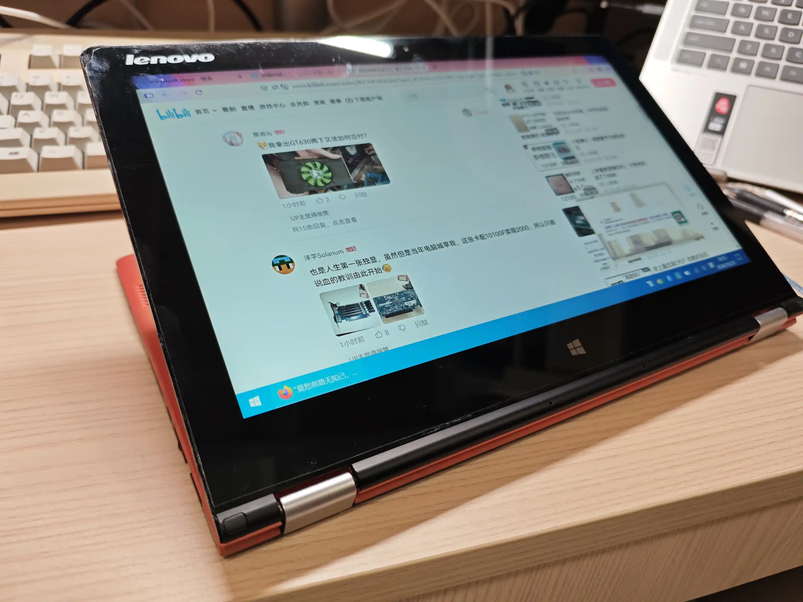
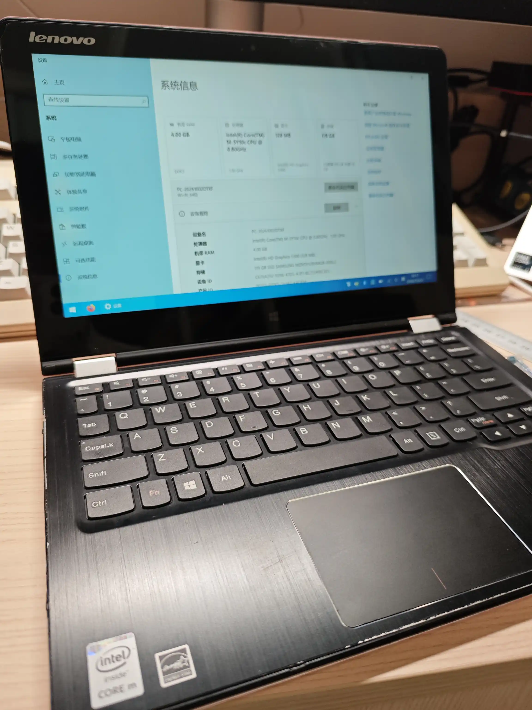
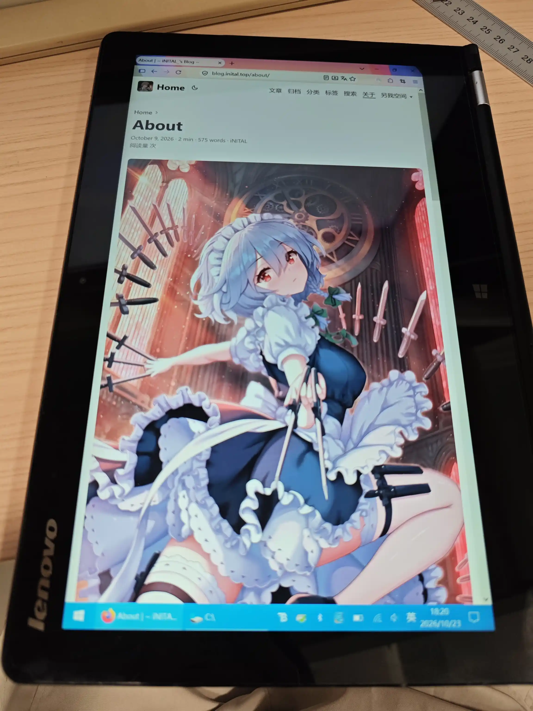
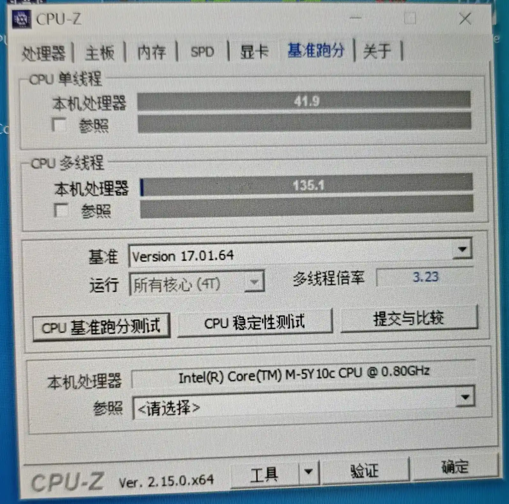
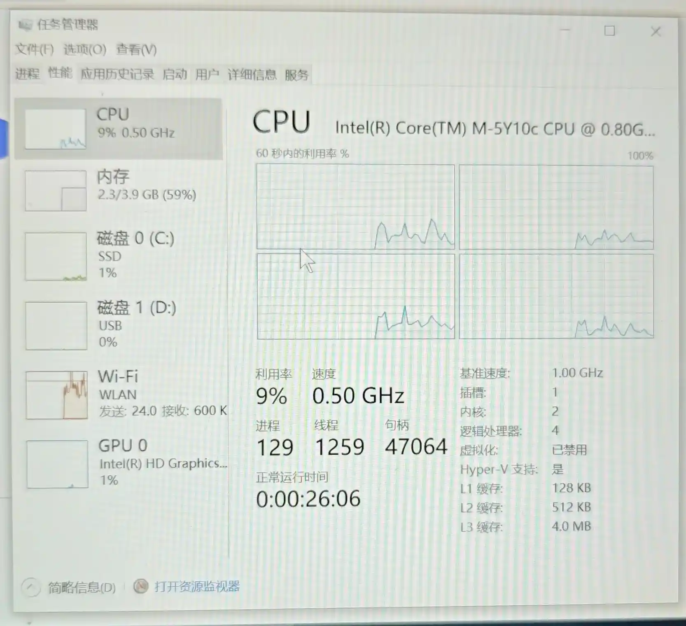
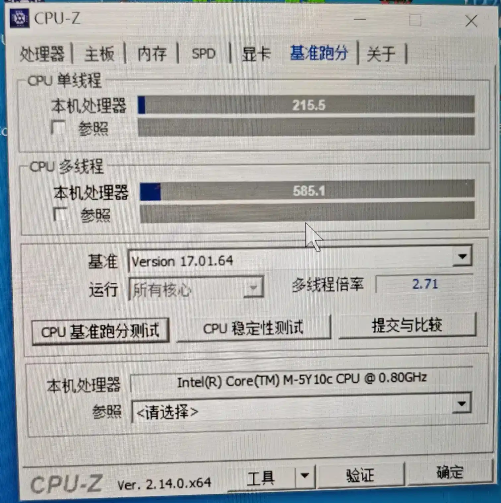
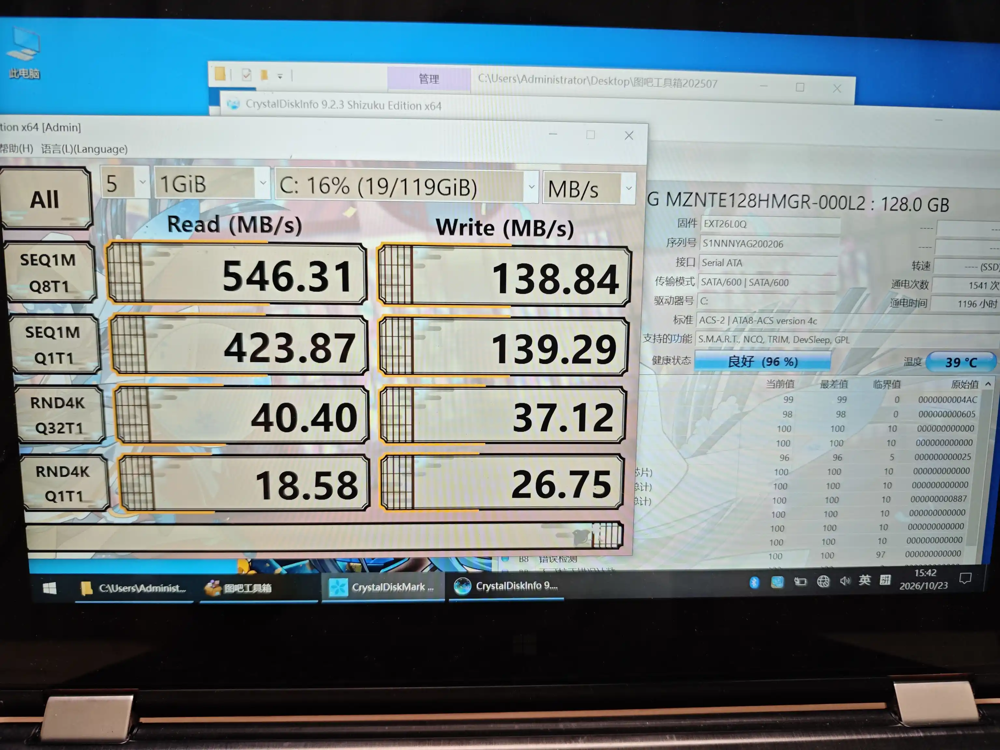
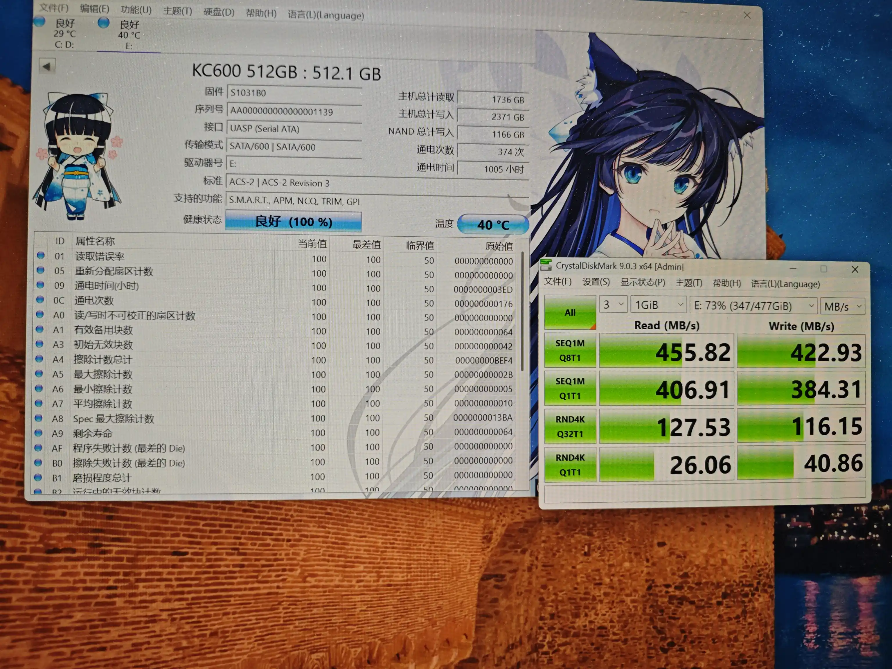

## 起源

本来，这种 Windows 平板一百来块钱也是比较平常的价格吧。毕竟前段时间顶配的小米平板 2 也就 100 来块前。如果预算加到 200 到 300，还能买到最低配的 ThinkPad X1 Tablet。

但是折腾过 ThinkPad X1 Tablet 的人都知道（*这里就留个坑吧*），这玩意儿的发热很离谱，完全就可以当作暖手宝。而且这台机器的自带键盘虽然在同类产品中很优秀，但是故障率很高，排线很容易断，故 DIY 键盘的相关产品比较多。虽然 X1 Tablet 本体不贵，但是作为一台 ThinkPad，键盘才是灵魂，100+才能买到能用的键盘，这实在让人难以接受。

如果你用过 Intel Atom 相关的产品的话，你又绝对会对其机器孱弱的性能印象深刻（当然，在我心目中，ARM 才是 Windows 平台 CPU 的下水道）。而且，小米平板 2 毕竟是个平板，接口数量很少，传输数据，外接键盘什么的还是很麻烦的。（当然，这类机器的本职一般就是玩 Galgame 而已）

当然，上述两条理由还不足以我捡这种垃圾。平时看到的 170 元的都是带 64g 的硬盘，但是这次，是带 128g 的硬盘，这就挺不错的。虽然成色看着一般，但是硬盘就能回将近一半的本，不亏。于是就果断下单了。

## 外观

比想象中更厚，更重一些（从平板的角度来看，1.1kg 确实不太适合握持，还是在桌面上立着更好）。而且尺寸也挺大的，量了下将近 14 寸。

形态就和印象中的 YOGA 一样，随便变换。作为一台 2014 年的电脑，屏轴还是非常稳定，阻尼感很不错。

整体橘色的漆面还是挺好看的，现在的笔记本电脑在配色上确实没有以前那么多样了。不过上边的特殊涂层时间长了比较粘手，也算是通病了。

键盘，因为是 14 寸的本子嘛，所以也都是全尺寸的，而且方向键也不是那种“全高 + 半高”的恶心组合，还是不错的。但是键程极短，敲下去手感很差。只能算及格。

## 配置

### CPU & GPU

反正是核显，所以就一块儿讲了。

一开始 CPU-Z 测下来的图如下：

然后急忙转头看了下任务管理器：

很明显，锁频了，而且给我锁到 0.5GHz 去了。人都傻了，长这么大，还真没见过 0.5GHz 的 CPU，都是图拉丁赛扬起步的。（当然，Book 8088 不算）

然后关了功耗墙，我还以为发热多大呢。满载都撞不到 80 摄氏度，你降什么主频？满载 7w 顶天，从续航角度上也没有任何帮助。

然后就正常多了：

这个分数，实际上也就能正常使用了呢。搭配五代酷睿的核显，玩玩东方 Project 相关的 STG 绰绰有余。解码 4k 也不算难事。在我捡的一众垃圾中，实用性还是可以的。

跑原机主装的精简 Windows 10 22H2 一点都不卡。

### 内存

4g DDR3，板载。没太多好说的。内存不多，但是也不构成瓶颈。

### 硬盘

重头戏，这可是我买这台电脑的一大原因。

2014 的笔记本，带 m.2/NGFF 插槽确实很唬人。不过猜一猜都能想到，是 msata。不过，就算是 msata，一块 128g 的三星二手价格也在 80 多，很可以了。

作为一块早年的 msata，可以看出在随机读写，顺序读入等方面都可谓一塌糊涂。这个随机读写总觉得还打不过一些杂牌 sata。不过再怎么说也是个固态，肯定比机械快很多的。

### 网卡

非常垃圾的 Intel AC3160，虽然是可更换 m2 插槽，但是由于白名单限制，升级不了 AX200 之类的主流网卡。而且，YOGA 系列也不像 ThinkPad 系列那样有庞大的 DIY 社区，没有破解的 BIOS。

但是，极限速度只能跑到 10 Mbps 的网卡，真的，不可饶恕，最主要你也没有以太网接口啊。这下拿来看 Bilibili 都没法开三倍速看视频了。

### 屏幕

在 2014 年，那个 1366 * 168 的 TN 屏还是大多数的时代，这块 11 寸的 1920 * 1080 的 IPS 触摸屏确实让人眼前一亮。虽然 45% NTSC 在如今已被列入垃圾屏幕的行列（当然，如今很多厂商的低端产品依旧是 45% NTSC）

说实话，分辨率没必要再高了，11 寸上 1080p 的显示已经很细腻了。

但是，你是一台将近 14 寸的笔记本啊？你就塞了个 11 寸的屏幕？

我自认为是个不在意屏占比的人，但是你左右边框都 1.5cm 了，下边框更是来到惊人的 2cm（这下真是“惊掉下巴”了）。我寻思 Tablet PC 时代的远古 Windows 平板也不至于如此吧？真的看什么都觉得很小。

而且作为一个平板，16:9 的比例真的很不合适，横着太宽，竖着又一长条，很不好用。

### 摄像头

支持 720p 视频，中规中矩。考虑到这台机器在角度调节上比较自由，以后拿来做拍摄设备也不是不行。

### 接口

作为一台定位轻薄的笔记本，给的接口可谓大方：

- USB-A 3.0 * 1
- USB-A 2.0 * 1
- mini-HDMI * 1
- 3.5mm 耳机口
- USB-A 充电口（我这辈子也是第一次见到 A 口的充电口）
- 全尺寸 SD 卡槽（这个还是挺意外的）

另外，侧边还集成了一些按键：

- 音量 +/-
- 开机键
- 旋转 锁定/解除锁定
- reset 键

还是挺实用的。就是缺少个 USB-C，用不了我现成的拓展坞，不过毕竟是 2014 年的机器，没有 C 口也正常。

### 续航

电池健康度 80%，加上 Core M 系列堪比 Atom 的功耗，续航能达到 2-3 个小时甚至更长，还是很意外的。

## 换网卡！

虽然有白名单限制，但是更换同机型顶配网卡还是可以的。虽然依旧不咋地，但是速度理论上是比原来快一倍的。

博通 BCM94352Z，要 m.2/NGFF 插槽版本的，而且还必须是联想的（戴尔和惠普的不行），FRU 必须为 04X6020（别的备件号不行），条件可谓苛刻。不过这样网卡本身还是挺熟悉的，著名的黑苹果网卡。

18 元包邮，实际上觉得有点小贵，毕竟一张 AX200 也就 30 左右。

备件还没到，过几天再更新吧~
