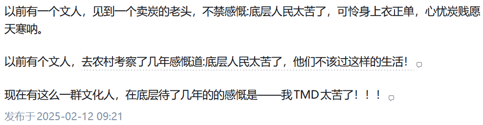
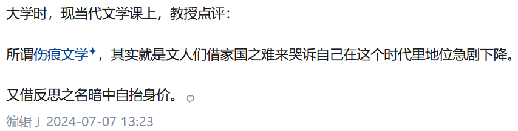
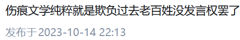

## 缘起

个人对于“文革”相关的历史非常感兴趣，阅读过不少书籍资料，也度过许多具有“伤痕文学”性质的小说。远远算不上什么专家，不过是一个读者而已。

但是，在知乎上看到[为何现在的年轻人对伤痕文学无感甚至反感？](https://www.zhihu.com/question/418687587)中的高赞回答时，我是真的非常震撼。**人的无知怎么能到达这种地步！**

一群人对着一个不存在的目标，整一个像是“虚拟读书会”一样的东西，然后妄加批判。甚至不少人还借此美化“文化大革命”，这不是荒谬吗！

说得好听，打着农村底层劳动群众的名义，去混淆人民大众的视听，忍无可忍！

## 所谓“老百姓”眼中的“文人”

在这群所谓的“底层人民”中，“伤痕文学”的主体是什么呢：
