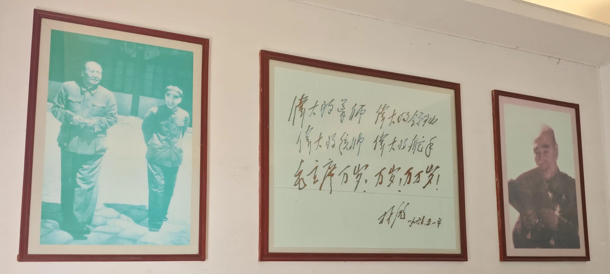
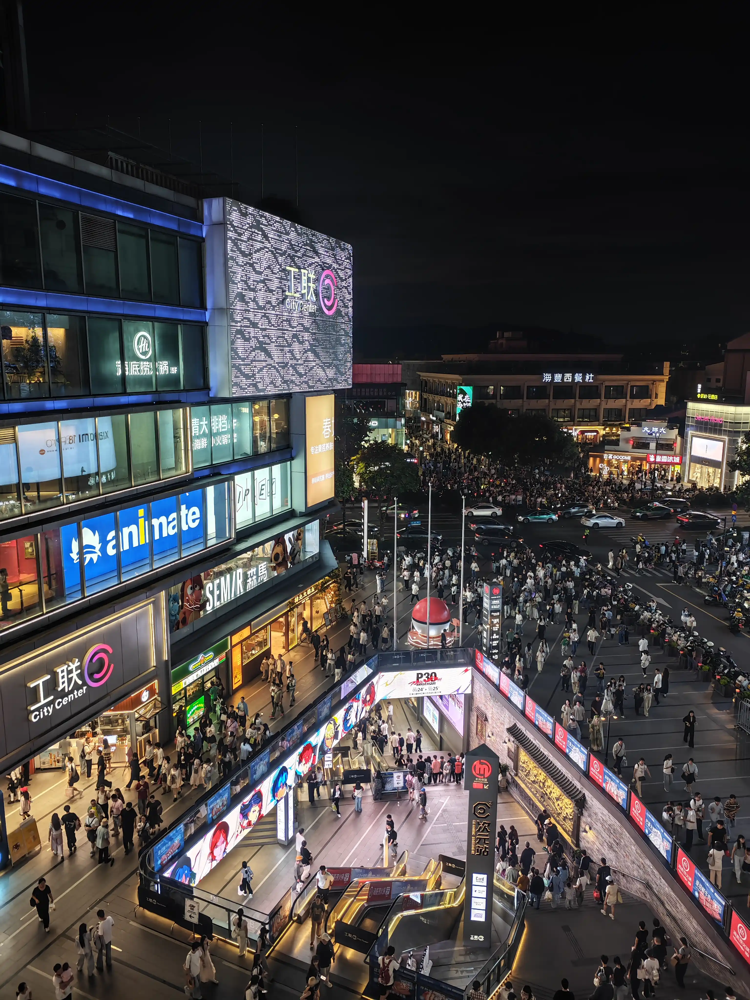
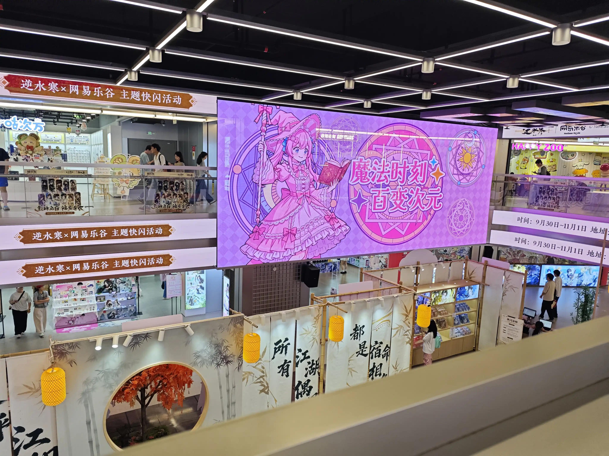

周六正好没什么事，所以就打着为实践作业取材的名义去杭州玩一趟吧。

## 草率的开始

本来想乘高铁去杭州的，不过如果买了高铁票那么出发的时间就定死了，如果突然想睡懒觉就很烦，于是就选择了坐地铁，回程选择高铁。

9:42 打上车，去城市广场站，到达时间 10:02，共花费 18.77 元，觉得还可以。一下车看见的就是北纬 30 度地理馆、绍兴大剧院、大善塔三件套，有一说一，设计得很好看，作为城市地标还是很不错的。看了一眼地图，附近估计是绍兴的中心商业区吧？以后周末没事可以来转转，打车费还算能接受。

并没有在城市广场久留，毕竟这不是今天的目的地。10:07 城市广场站上车，11:06 姑娘桥站下车，转杭州地铁 5 号线。用时一小时左右，比想象中好很多。地铁中途有一段地面路线，穿过了几个隧道，也不得不感叹绍兴这地方山真多啊（作为一个嘉兴人对于山总是很稀奇的）。

11:44 到达江城路站，转 7 号线，之后于 11:52 到达吴山广场，就此，机动交通部分算是结束了。地铁价格总共加起来花了 14 块钱，额，考虑到路程，勉强能接受吧（但是我地铁 + 高铁的组合也没有贵多少啊）。

在吴山广场下车的时候，看见一段路封着，才发现这里是马拉松的终点呢。也是第一次亲眼见到马拉松比赛的进行呢，挺巧的。

导航指示要坐半个小时的 510H 路公交车，就可以到达了。不过我不想等公交，走路过去，路上顺便吃个饭，不是挺好的吗？

然后我就会为了这个决定痛苦一下午。

## 旅行 or 拉练？

实际上在吴山广场站附近看见了几家吃的，但奈何个人对杭帮菜实在不感冒，于是就跳过。

这个时候似乎人还不算太多，所以沿着西湖走，风景也不错。拍了几段西湖的视频，实践作业如果要搞视频的话，可以用在导入部分吧？

中途还顺路去太子湾公园逛了一会儿，树荫、池塘、木桥。正是日中心，在这样的路线行走还是很愉快的。

中途还碰到一家看着不错的小店，馄饨 + 煎饺共 35 元左右，考虑到在西湖，虽然量有点少，但也能接受，然而还是固执地认为应该有别的更好的去处吧？然后，之后的行程，就再没有遇到过像样的饭店。

随着终点的逼近，能越来越感受到山林的气息了呢，觉得一直都在走上坡路，人烟也渐渐稀少。往来的人中，讨论林彪种种事迹的不少呢，大家都想趁此机会跟身边的人炫耀自己那偏门的历史知识么？(\^ _ \^)

经过于谦墓，没有逗留太久，就继续赶路。这段路似乎与山泉平行呢。对面路上似乎还有人在唱歌，歌声若隐若现，但始终没听懂在唱什么呢。

临近浙江宾馆，能感受到人行道越来越窄，最后干脆没有了；人群熙熙攘攘的声音逐渐消失，最后只剩下轿车从身边呼啸而过的风声。“导航也到此结束”，走到宾馆门口的时候手机突然这么说，真是的，明明还有好长一段路的说，只能自己找了。看了看路边，还有一个公交车站的牌子，上边有 510H 的字样，坐公交车的话，大概就到这里吧，大方向是准没错了。

此时，我还没吃过饭，也没喝过水。但是，到达目的地的喜悦让我暂时忘却了这些呢。

## 探寻荒诞的历史

相对于高耸入云的现代连锁酒店，浙江宾馆的整体风格显得更加低调、庄重呢。本来想在这里奢侈一把，吃顿饭的，不过看了看价目表还是劝退了。

刚入浙江宾馆的时候，指路牌并没有标注 704 工程，略微绕到宾馆后方，才在路牌末尾看到了 704 工程的字样。中途好几次怀疑是不是走错了，不过顺着路牌，最终还是看到了那个神秘的地下掩体设施，以及“704 工程”的字样，嗯嗯，现在是 13:22，终于走到这里了。这边的地理位置是多么得天独厚，大概只有亲自走过才能体会到吧。

### 潜入无懈可击的坑道

进入工程内部，炎热感很快散去，难怪很多本地人把这里当避暑胜地呢。一边贴着“文化大革命”时期，毛泽东和林彪的宣传画，以及实物“红宝书”等特殊物品，非常有年代感；另一边写着工程的种种技术细节，着重国防教育吧。从这里就可以看出这个地方的叙事基调了：着重于设施本身的介绍，而对于林彪和特殊时期的历史，不多讲，给你实物，你自己品。

收了 16 元的门票，哎，明明告示上说学生半票的来着，结果售票机上压根没有学生票的选项，也是没办法。

过闸机后，先看到的是一辆军车，以及整个工程的模型。模型做得还不错，非常直观地表现了工程的深度，难怪能防核打击呢。

正式进入坑道，首先就看到了好几个应急逃生通道，然后就是两扇重达 500kg 的混凝土三防（核打击、化学武器、生物武器）防护门。坑道内的灯管设计非常不错，色温偏黄，比较有历史的气息。而且隔一盏亮一盏，这样既能满足照明需求，又能保留坑道那种隐秘的氛围呢。走了一会儿，又碰到了一对防护门，这才没几步啊。

地下设施方面，最开始是洗手台和卫生间，然后是震耳欲聋的通风机房，随后就是警卫房、医务室、弹药库、发电房一类，可谓一应俱全。每隔几个地方就有电子加热器，不过肯定是没开的，林彪对于恒温的要求可是高得离谱的。

指挥机构方面，有作战室、会议室、接待室、休息室、通讯室等，配上六七十年代的中国地图和毛泽东语录，布置还算得当，也很能看出林彪对房间“空”的执念。其中，通讯室张贴的“工作守则”令人印象深刻：
> - 不该说的秘密不说
> - 不该问的秘密不问
> - 不该看的秘密不看
> - 不该带的秘密不带
> - 不在私人书信中涉及秘密
> - 不在非保密本上记录秘密
> - 不用普通邮电传递秘密
> - 不在非保密场所阅办、谈论秘密
> - 不私自复制、保存和销毁秘密
> - 不带秘密载体游览或者探亲访友
> 
不过这里的灯光有点过亮了，而且是白光，走过来就很明显觉得有点割裂。

其余坑道的墙面，主要聚焦704 工程的建造过程，以及林彪的“战神之路”。实际上，这里的大头都是介绍林彪在建国前的赫赫战功呢。不过确实，林彪是军事天才这一点，无可争议。

指挥机构的尽头似乎是电影放映室，这里本来很期待呢，毕竟没准林立果那句经典的“我们也是联合舰队！”就是出自这里呢，可惜没开放。

走过著名的回音走廊，不知道是不是因为人比较多，声音本来就很大，所以根本听不清脚步声，更不用说在林彪卧室听见了，也是一大遗憾了。

回音走廊的尽头，有一个林立果展厅，并陈列了与林彪同谋将领的生平，不过都是点到为止，比较传统。哎，关于林立果，我还希望有更多的介绍的说，毕竟他身上好玩的梗实在太多了。好歹介绍个“超天才”嘛！

*（顺便一提，多年前，在游戏《主播女孩重度依赖》刚刚发布的时候，我就觉得“超天酱”这个名字好熟悉来着，然后转念一想就绷不住。我们的“超天才”可是真的物理意义上“†升天†”了，版本大领先说是）*

走过林立果展厅，就是关于国内外地下军事设施的介绍，以及林彪各种故居的介绍吧，实际上没什么，也没细看。边上是直达林彪卧室的电梯，似乎早年还能用，不过现在当然是不开放的。

### 步入背离历史的住所

只能顺着楼梯走到林彪卧室二楼。刚到二楼就是那张经典的林彪拿着红宝书的宣传画，现在看来有点滑稽。

走到卧室，不得不感慨，地下坑道的布置还是太紧凑了。不是，这个空间整三个卧室都没问题吧？你就整了一张床、两张沙发和一张书桌？柜子都没几个？这不是喜欢来回踱步了，这都可以在房间转圈圈了呢。

房间的物品上，有那个看上去就很轻盈的吊灯（用布蒙起来的，灯光应该比较柔和），据说掉下来非但砸不死人，而且连风都不会感觉到。其他灯具，基本都嵌在吊顶中，漫反射照亮房间。四层窗帘名不虚传，看着就非常厚。还有很多古代字画，和很多毛泽东的真迹（才知道是抄家抄来的，不得不说，毛泽东真迹都敢抄，确实不要脸）。当然了，电子加热器也是必须的。

走到林彪办公室，布展方还放了林彪人偶坐在沙发上呢，符合刻板印象。不过，整个办公室最引人注目的，估计就是这个了吧？

这真是传世经典了。我真的很难想象，到底是经历了什么，让林彪从那个不被常识束缚的，运筹帷幄的天才将领，变成这样只会随声附和的“副主席”的。每每想到这，都不免发笑，又不免感到可惜。有时候，历史就是这样啊。

走到书房，这里没有什么太出乎意料的东西呢，林彪的战绩，至于他的神话，已经耳熟能详了。林彪及其亲属能利用身份便利看到非常多香港、外国的电影，以及各种音乐和书籍。那个年代，有这种“批判性观看”的权利的人可不多呢。

“文化大革命”的荒诞，实际上他再清楚不过了，因此才想要用《571 工程纪要》这种文件来笼络人心，发动政变么？诚然，《571 工程纪要》中的内容极具迷惑性，但是，想让新中国变成“林家王朝”的野心却毫不遮掩。接触着外界先进的思想，打着“革命”“解放”的旗号，却做着封建的事，不是很矛盾么？

阳台非常空旷，只有倾洒在白色瓷砖上的阳光。栏杆上是褪色的介绍文字，是关于恒温游泳池和日光浴池的。对于日光浴池和游泳池的介绍文字，最终在阳光与雨水下消散，这就是所谓“宿命感”么？

据说，这里的屋檐有特殊设计，下雨的时候听不到雨声呢。不过，今天这个大晴天，也是没法验证了。

### 走出矛盾螺旋的工程

看完林彪住所，原路返回，走出 704 工程，顺便可以再录一次素材。

重新感受到温暖的阳光，身上的潮气一扫而空。真是的，一个连阳光和微风都害怕的人，即便侥幸篡权成功，也不会有什么好结局吧。

这时候才发现，坑道口还别出心裁放了一辆 59 式坦克，以衬托这里的“国防军事教育基地”的氛围呢。国内能看到坦克的地方可不多。不得不说，即便是 59 式，看上去也是高大威猛啊。不过，坦克边上也是杂草丛生呢，似乎也没人打理。它也和坑道一样，困在了那段静止的历史里吧。

哎，真是的，光想着给坑道拍素材了，难得一见的 59 式竟然没拍照，可惜啊。

## 寻找歇脚之处

任务是完成了，走出浙江宾馆，然后呢？

喂喂，现在都 14:16 了，当然是吃饭去啦！不然真要饿死了！但是，哪里有相对实惠的吃的呢？

管他呢，先远离这个是非之地再说。先导航去浙江省革命烈士纪念馆吧，路上找吃的，如果时间允许，还能顺路去看看。

结果，真的不知道走过了多少个 1km，虽然沿途看到不少小桥、垂柳、游船、镜湖、浮萍、群山，也拍了不少照片，但确实累了呢。西湖确实，不管什么角度都很美呢。

*（图片见封面）*

不得不说，在去商业化，保留游览体验这方面，至少对于西湖那些不那么热门的景点来说，是做得非常好的。如果是平常，我非常愿意在这里漫无目的地闲逛，然后漫无目的地拍照，但是现在不行。

满脑子都是在吴山广场地铁站内看到的罗森，真是的，那时候买个关东煮也不至于这样。或者之前看到的那家餐厅也还行啊。

于是，一直走，终于，在 15:27，看到一个卖关东煮的，再也忍不住了，买了三串，外加一瓶雪碧，一共 23，确实宰人，但不买我真的会死掉的啊。找了个椅子，稍微休息了一会儿。虽然很饿，但依旧觉得他家的关东煮不怎么好吃。

## 新的目的地

稍作休息之后，总觉得这时候去浙江省革命烈士纪念馆也看不了多久就关门呢。那么，换个地方吧。去哪里呢？

在上海，每当想不到去哪里好时，那就去百联和百米香榭。在杭州，那就去工联 CC。

虽然还有好几 km，不过，也不算太远，继续走下去吧。

## 混入资本主义世界

很明显感觉到人渐渐多起来了，也吵闹起来了。似乎有歌唱的表演，但是那个喇叭破音真的很严重啊，完全就是噪音。没过多久，就变得人山人海了，商业区到了。

华为和苹果的店面非常大，但依旧挤满了人。实际上，公交车站处处都是 iPhone Duo 的广告呢。不是，这个行情，还有这么多人买啊？有钱人还是太多了。

已经能看到银泰百货和工联 CC 了，美团叠券的话，还是能以相对可负担的价格吃一顿的吧？不过，总觉得，一个人不太适合在这种店里吃饭呢。于是乎，走到了银泰的顶楼，又走了下去。

走到工联前的十字路口，真的非常繁忙呢，红绿灯一切换，人群就像潮水一样涌过。天色略暗，灯光初显，今夜似乎不会平静呢。

在工联边上的一幢楼看到了一家老娘舅，就那里吧。很久没吃老娘舅了呢。

吃完饭，喝了几杯大麦茶，买好了回程的高铁票，然后就拿上包去工联了~

### 工联 CC，Again

上次来工联 CC，还是三位一体面试的时候呢，也是想不到去哪里好，所以过来的呢。

真是的，现在也没法“刻意”去工联呢，交通上还是有点远。等搬到杭州校区可以考虑，不过那样对我的钱包真是太不友好了。

工联实际上和我上次来没太大变化。二楼那几家模型店似乎没有换展品，街机厅的话，无非那几个音游机台，转了一圈也没发现传统的街机框体。意料之中，要玩传统街机还得去上海烈火。

一直往上走，似乎有很多关于地下层的宣传标语呢，上次怎么没注意到地下呢。顶楼基本都是密室逃脱，桌游聚集地，还有类似于露天集市那种谷子摊子吧。不过发现似乎有个通道能出去，这才发现工联还有露天的部分呢。每一层的布置都不一样，顺着台阶一点点走下去就很有意思呢~

突然想走到顶楼拍张照片，于是又转上去~

等一等，animate 和 ANIPLEX？我怎么没看到？

回想起楼内 B1 层/B2 层的广告，果然么？啊啊啊，那我上次来的时候可太粗心了！

### 工联 CC，Extra Time

本来发愁距离去火车站还有好久时间呢，这下可好，得担心时间不够了呢。

走到 B1 层，就似乎来到了一个完全不同的世界呢。首先看到的似乎是一大片宝可梦的专区，不过我对宝可梦不感冒，于是速速掠过，直奔 animate。

#### animate

果然，animate 没让我失望。整体布置和上海那几家差不多，可能还要大一点。首先还是直奔漫画和画集的专区啦！画集，有明日方舟之类的二游专区，也有像是 Fate 系列、新海诚系列的专区，当然啦，诸如《东方 Project人物图鉴》《东方归言路图鉴》之类的也是有的啦！转头还能看到《东方三月精》《东方醉蝶华》的漫画，价格上和网上差不多呢。

突然看到有灵梦和魔理沙的立牌呢，第一反应是，会不会是其他 IP 长得像的角色？然后又看了下货架——竟然给东方 Project 专门开了个柜子？！我活到头了？！这是我们车车人能有的待遇吗？！这是异变啊喂~！（百米香榭的红魔馆都没这么多东西）

就在这时，传来熟悉而又亲切的音乐——《Bad Apple!!》，真是莫名的感动呢。我就说嘛，9 月份红魔乡新典发售肯定对东方的宣传有帮助的啦~。此时的脑中 be like：

> 我东正蒸蒸日上！
> 
> **Make Touhou Great Again!**
>

更加称得上是双喜临门的是，东方 Project 边上的货架就是《主播女孩重度依赖》的货架。*~~果然呢，下午看“超天才”，晚上看“超天酱”，这才是兼容并蓄嘛~~*

随着对店面的探索，熟悉的面孔也渐渐增加呢，像是 FGO、孤独摇滚！、超时空辉夜姬！之类的都有呢。

像是前不久的新番的原版漫画也有个几卷，时效性上绝对有保证呢！

好啦，此地不宜久留，不然就忍不住买了。

#### DLsite & 岛丸屋

看到 DLsite 的名字，以及门口《缎带英雄》《Angel Beats!》的立牌就进来了。虽然《缎带英雄》的脚本一塌糊涂，但是蓝宝石是真的帅啊！那几个立牌看上去不错呢。

还有《Angel Beats!》，我超喜欢游离子的呢~（虽然人设上个人认为就是凉宫春日的翻版），还有呆呆的立华奏，天使装也是很漂亮呢~。既然 AB 能有专展，没准我哪天能看到凉宫春日、LB、CL 之类的呢。越来越期待了~

不过依旧忍住没买。

走到过道，那个透明的屏幕显示效果很不错呢！场景布置上还是用了心的~（虽然有点 AI 味道，不过不好下定论，万一误伤画师）（那两个魔法阵，太阳 + 月亮，莫名联想到《神无月的巫女》了？）

还是很希望以后能在这块屏幕上看到喜欢的 IP 和喜欢的角色呢~

如果以后能支持付费投屏的话，一定要用一次呢！让大家都好好看看我推！~

#### GSC & ANIPLEX

看过 B1 后，顺着来到了 B2。

这两家也是常客了。买是绝对不会买的，觉得店家也没想着让你买，纯纯把东西放在那里炫技的吧。在这边橱窗购物再好不过了。

GSC 的粘土人每次都会让我蹲下看好久，做工是真的不错，不过也是真的贵。一般就是等国内三十来块钱的盗版，到手后手工打磨/补色下，也像是那么回事。

《孤独摇滚！》的四人组粘土人还是一如既往的可爱呢。真是百看不厌。

至于 ANIPLEX，额，果然隔了一天不记得有什么了吗（*没错，本文是 10-18 写的*）。哦，对了，有《上伊那牡丹，酒醉身姿似百合花般》，还放着 OP 的曲子。还有印象比较深的就是新版《魔法少女小圆》的海报了。不要光放着海报啊！什么时候国内上映呢？不能上映的话，也早点出蓝光吧？好从压制组那里白嫖。真是的，从宣发开始就搞得神神秘秘的，一直吊着人，莫名其妙。

#### Other

其他的店也都不错啦，也能看到不少熟悉的 IP。一家模型店我还看到了合模线的星花百合——这个真不如我做的了，我好歹上了水贴，他这纯素组啊（虽然素组效果就不错了）。

这边的万代不太给力呢，就开了一家卡牌店，如果是我堂弟的话可能会喜欢吧。

一角还有一家女仆咖啡馆，还是第一次在现实中见到女仆咖啡馆呢。在女仆咖啡馆喝一杯咖啡，是多少阿宅的梦想呢？不过反正我一个人绝对是不好意思去的啦！就算去了也绝对会尬死。（当然，价格也是一部分原因）

最后来到一家名为 TAPIOCA SHANGHAI 的小店，这边有辉夜姬、糖糖和东方 Project 的立牌，就在这里买一件吧，就一件。本来想买个八千代，保佑我网站正常运行的呢；也可以买超天酱，预祝我一个月 10w 粉丝？

不过，最后面对一排东方 Project 的盲盒，还是下了决定呢。我本来很不喜欢盲盒这种东西，不过，这次我正好纠结买哪个比较好，毕竟东方的主要角色我都挺喜欢的（当然啦，如果是 Sakuya 就更好了），那就随便来个吧~。刚好替我做决定。

把盲盒装入书包，恋恋不舍在地下转了几圈，然后买了瓶饮料就去坐地铁了。

## 回程 ~

于 19:10 进入龙翔桥站，上车。

很奇怪，一开始我看站外边排了好长的队呢，但实际上去百联，坐扶梯下去，一样也能到地铁站啊，搞不懂。

19:30 到达杭州东，下车。距离发车还早着，买点什么一般在学校吃不到的东西呢？好吧，那就麦当劳的甜筒吧~

吃完甜筒，等个几分钟，差不多就准备上车了呢。

20:23 发车~

20:43 到达绍兴北~

下车的时候，旁坐的人很是诧异：“这就走了？”。

是的呢，这也是我坐过的时间最短的高铁了。

打车回 HDU，共花费 44.19，小贵，下次还是打算先坐地铁到城市广场，之后再打车，能省一半。

## ~ SP ~

